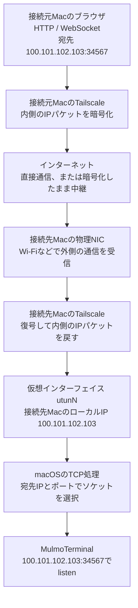
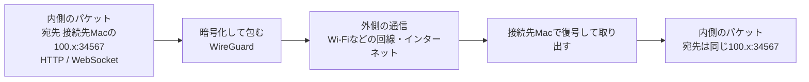
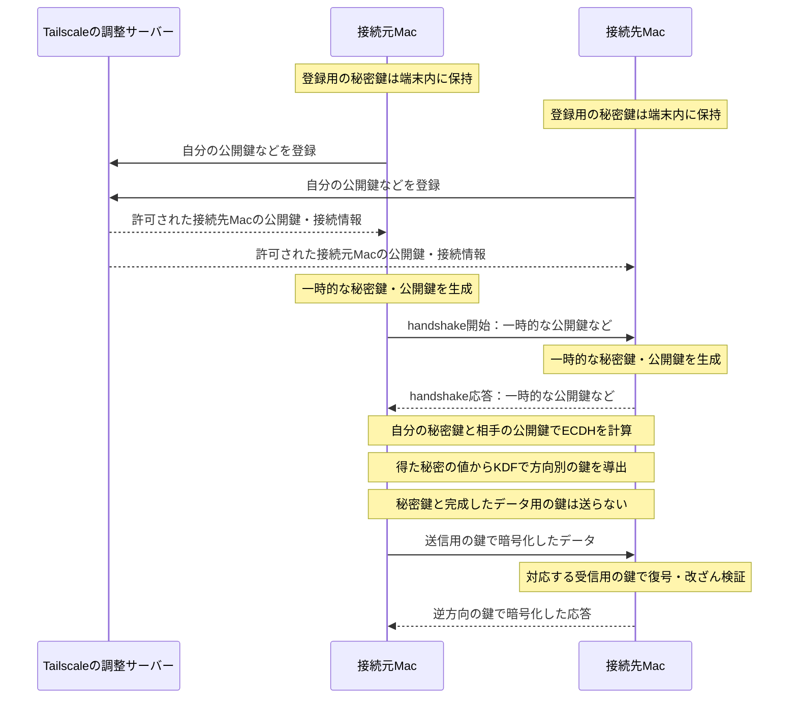
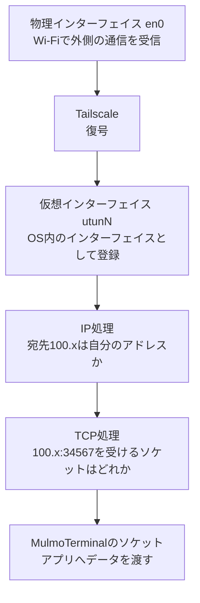
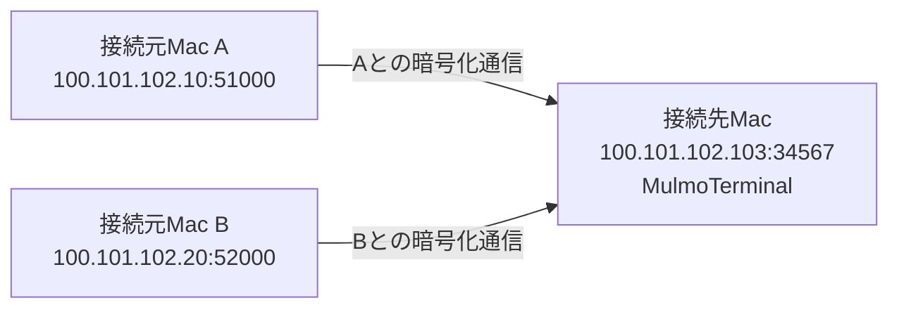
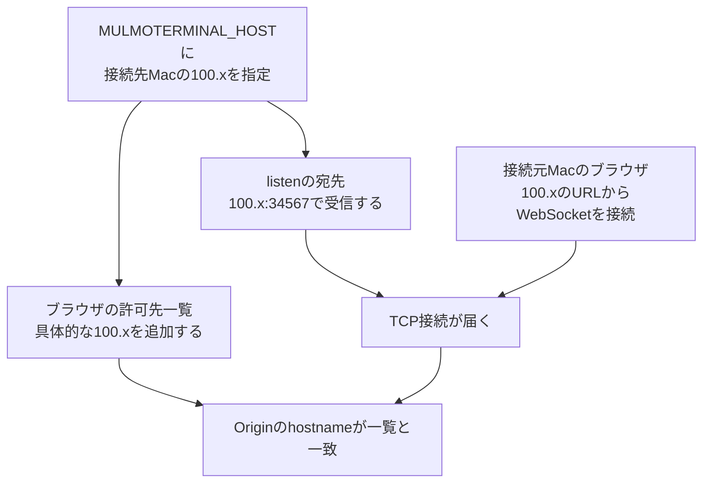

## 要旨

ブラウザを開くMac（接続元Mac）から、MulmoTerminalを動かすMac（接続先Mac）へ、Tailscale経由でアクセスする方法を紹介します。対象はTailscale Standalone版1.104.1を使う接続先Macです。前半で準備、待ち受けを指定した起動、接続元Macで開くURL、接続確認までを示します。後半では公式文書の原文と公開コードを読み、暗号化した通信が接続先Macへ届き、指定したIPとポートの受け口へ渡る仕組みを追います。実機では接続先MacのIPと待ち受けを調べ、別のMacのブラウザから接続しました。

## MulmoTerminalを接続元Macから開くには

[MulmoTerminal](https://github.com/receptron/mulmoterminal)は、Claude CodeやCodexなどのAIコーディングエージェントを、ブラウザの1つの画面に並べて使うツールです。エージェントは、依頼に応じてコードの作成や修正を進めるプログラムです。MulmoTerminalでは複数の作業を見渡し、入力を待っているセッションへ移って返事をできます。基本の使い方や画面は[公式の日本語ユーザーガイド](https://www.mulmoterminal.com/guide/ja/)で確認できます。

この記事では、ブラウザを開くMacを「接続元Mac」、MulmoTerminalを動かすMacを「接続先Mac」と呼びます。Web UIは、ブラウザに表示する操作画面です。今回、接続元Macのブラウザから接続先MacのWeb UIへ接続しました。エージェントやターミナルは接続先Macで動かしたまま、接続元Macを画面と入力の窓口にします。

### MulmoServer経由と、今回の接続の目的

今回の目的は、接続元Macのブラウザで、接続先MacのMulmoTerminalのWeb UIを直接開くことです。HTTPはWebページなどを取得する通信方式です。WebSocketは接続を保って双方向にデータを送る仕組みで、ターミナルの入力・出力に使います。その通信を運ぶために、離れた端末同士を暗号化した通信でつなぐ[Tailscale](https://tailscale.com/docs/concepts/what-is-tailscale)を使います。

既存の別経路として[MulmoServer](https://github.com/receptron/mulmoserver)があります。[Remote Hostの公式仕様](https://github.com/receptron/mulmoterminal/blob/ae270ae7c8609b8f3c04d891241bce9a30f96a13/docs/remote-host-protocol.md#transport)には “It talks to MulmoTerminal over Firestore command docs, not HTTP” とあります。訳すと「HTTPではなくFirestoreの指示データを介してMulmoTerminalと通信する」です。この経路では、接続先Macが[Firebase Authentication](https://firebase.google.com/docs/auth)でサインインします。[Firestore](https://firebase.google.com/docs/firestore)はデータを保存・同期するサービスで、接続先Macはそこに届く利用者ごとの指示を受け取り、処理結果を返します。

MulmoServer経由は、接続先Macへ外から直接接続できない環境でも指示を届け、結果を受け取れる経路です。一方、今回はWeb UI自体を別のMacから開くため、Tailscaleで端末同士をつなぎ、HTTPとWebSocketで直接アクセスします。目的に応じて使い分けるもので、今回のWeb UIへの接続にはFirestoreの指示の中継を使いません。Remote Hostなどを別に有効にしていれば、その機能の通信や保存は続きます。直接接続したことだけを根拠に、Firestoreへの記録がすべてなくなるとは言えません。

:::message

MulmoTerminalのコードは[ae270ae7c8609b8f3c04d891241bce9a30f96a13](https://github.com/receptron/mulmoterminal/tree/ae270ae7c8609b8f3c04d891241bce9a30f96a13)に固定して確認しました。対象はTailscaleのStandalone版1.104.1を使う接続先Macです。手元ではutun9へのTailscale IP割り当てと、接続元Macのブラウザからの接続を確認しています。ブラウザからの接続確認と、以下の公開コードに基づく仕組みの説明を分けて記します。以下の100.101.102.103は説明用で、実際には接続先Macのアドレスを使います。

:::

## 接続元Macから接続する手順

ブラウザの操作は、次の経路で接続先MacのMulmoTerminalへ届きます。100.101.102.103は説明用のIPで、実際には接続先MacのTailscale IPv4へ置き換えます。図の各段階は後半で詳しく説明します。



### 準備するものと接続を許可する範囲

離れた2台のMacをつなぐために使うのが[Tailscale](https://tailscale.com/docs/concepts/what-is-tailscale)です。端末にアプリを入れてログインすると、許可した端末の間に暗号化した通信経路を作れます。導入手順は[公式クイックスタート](https://tailscale.com/docs/how-to/quickstart)にあります。公開コードは[Tailscaleの公式リポジトリ](https://github.com/tailscale/tailscale)で読めます。

それぞれの役割を整理すると、次のようになります。

- MulmoTerminal：接続先Macでターミナルやエージェントを動かし、ブラウザ向けの操作画面を提供する
- Tailscale：接続元Macと接続先Macを接続し、通信相手の情報の配布やアクセス制御を担う
- [WireGuard](https://www.wireguard.com/)：Tailscaleが端末間の暗号化通信に使うVPNの方式と、そのオープンソース実装。VPNは、離れた端末の間に仮想的な通信経路を作る仕組み

今回、利用者が導入するのは接続先Mac側のMulmoTerminalと、両端末のTailscaleアプリです。WireGuardのアプリを別に入れて設定する手順はありません。Tailscaleが内部でWireGuardを使います。

- 接続先Mac側でMulmoTerminalを起動できる環境を用意します。Node.jsと使うエージェントの準備は[公式の導入ガイド](https://www.mulmoterminal.com/guide/ja/getting-started.html)に沿って行います。
- 接続元Macと接続先MacにTailscaleを入れ、同じ自分のネットワークへ参加させます。[公式クイックスタート](https://tailscale.com/docs/how-to/quickstart)が、アカウント作成と端末の追加を説明しています。
- 接続先Macは起動したままにし、スリープに入らない状態で確認します。接続元Mac側のTailscaleも有効にします。

この接続は、接続先Macのターミナルを操作できる経路を作ります。確認対象のMulmoTerminalには独自の利用者認証がありません。[固定commitの起動警告](https://github.com/receptron/mulmoterminal/blob/ae270ae7c8609b8f3c04d891241bce9a30f96a13/server/infra/http/allowed-origin.ts#L117-L126)で確認でき、後半にその原文とコードを示します。[Tailscaleのアクセス制御](https://tailscale.com/security#access-controls-lists-acls)で、自分の端末から接続先MacのTCPポート34567へ接続できる範囲を確認してください。「Tailscaleにつながる全員を信頼してよい」とは考えず、必要な端末へ許可を絞ります。

待ち受けには接続先MacのTailscale IPv4を明示します。全IPv4で受ける`0.0.0.0`を使う手順にはしません。Tailscale側の許可とMulmoTerminal側の待ち受けは別の設定なので、両方がそろっている必要があります。

### 起動と確認

接続元Macと接続先MacのTailscaleを有効にし、両端末間の通信が許可されていることを確認します。接続先MacのTailscaleアプリで、その接続先MacのIPv4を調べます。コマンドでTailscaleを操作できる環境なら`tailscale ip -4`でも確認できます。

既存のMulmoTerminalが起動している場合は、作業を保存し、通常の終了手順で止めてから設定付きで起動します。環境変数は、起動するプログラムへ設定を渡す仕組みです。起動時に読み込まれるため、すでに動いているプロセスの設定は変わりません。

```bash
# 例のIPを、接続先MacのTailscale IPv4へ置き換える
MULMOTERMINAL_HOST=100.101.102.103 npx mulmoterminal@latest
```

`npx ...@latest`は[公式READMEの起動方法](https://github.com/receptron/mulmoterminal/blob/ae270ae7c8609b8f3c04d891241bce9a30f96a13/README.md#L308-L325)に合わせています。このコマンドは実行時点の最新版を起動します。この記事で読んだコードから変更されている場合があるので、利用する版の起動条件や設定も確認してください。

接続先Macで次を確認します。どちらも設定変更はしません。

```bash
# utun系に接続先MacのTailscale IPがあるか
ifconfig

# プロセスと待ち受けアドレスを確認する
lsof -nP -iTCP:34567 -sTCP:LISTEN
```

期待するのは、MulmoTerminalのプロセスが100.101.102.103:34567でlistenしていることです。接続先Mac内の接続用に127.0.0.1や::1が出ることもあります。

次に接続元Macのブラウザで開きます。

```text
http://100.101.102.103:34567
```

読み取り用の到達確認なら、Tailscaleに接続した接続元Macから次を実行できます。

```bash
curl --noproxy '*' --connect-timeout 5 -I http://100.101.102.103:34567/
```

HTTPの応答が返れば、接続元Macからサーバーへ接続できています。[HTTP仕様RFC 9110のメソッド一覧](https://httpwg.org/specs/rfc9110.html#methods)はHEADを “Same as GET, but do not transfer the response content.” と説明しています。訳すと「GETと同じだが、応答本文は転送しない」です。このコマンドはHEADを使うため、WebSocketのOriginチェックや接続元Macでの操作は確認できません。画面が開くのに接続中のままなら、起動時の許可先表示とWebSocket拒否ログを確認します。最初から応答がなければ、接続先Macのスリープ、両端のVPN接続、宛先IP、listen、アクセス制御の順に切り分けます。

ここまでが接続の手順です。今回確認したのは、Standalone版1.104.1の接続先MacのIPと待ち受け、接続元Macのブラウザからの接続です。HTTPの到達確認、画面の表示、WebSocketでの入力・出力は、それぞれ確認する範囲が異なります。

## 接続手順を支える仕組み

ここからは、前半で指定した接続先URLと起動設定が、なぜ必要なのかを説明します。図とコードは通信経路を説明するもので、実機で内部処理の全段階を測定した記録ではありません。

接続先には、Tailscaleが接続先Macへ割り当てた100.x.x.xというIPアドレスを使います。Wi-Fiに割り当てられたIPとは別です。[Tailscale公式のIPアドレス説明](https://tailscale.com/docs/concepts/ip-and-dns-addresses)には “an IP address in the `100.x.y.z` range” とあります。訳すと「100.x.y.zの範囲のIPアドレス」です。資料は、デフォルトで各端末へこの範囲のIPを割り当てると説明しています。この違いが、後半で確認する「通信の宛先」と「待ち受け設定」につながります。

ここからは、接続元Macから接続先Macのアプリへ届く通信と設定の意味を追います。OSはmacOSのように、端末全体を管理するソフトウェアです。localhostは、そのプログラムが動いている端末自身を指す名前です。この2つの言葉も、通信の受け渡しを説明する中で使います。

### 宛先は接続先Macの100.xのまま

接続元Macが`http://100.101.102.103:34567`を開くと、内側の通信の宛先は **100.101.102.103のTCPポート34567** です。TCPは、データの順序をそろえ、届かなかった分を送り直す通信方式です。[仕様RFC 9293の2.2節](https://www.rfc-editor.org/rfc/rfc9293.html#section-2.2)は “reliable, in-order, byte-stream service” と表現しています。訳すと「信頼性があり、順序を保ったバイト列の通信サービス」です。ポート番号34567は、その接続先Macで動くMulmoTerminalの受け口を指定しています。

送信側のTailscaleが通信を暗号化し、接続先MacのTailscaleが元に戻します。元に戻す操作を復号と呼びます。復号後の宛先も100.101.102.103:34567です。localhost用の127.0.0.1への書き換えは、この接続では行いません。

この記事で確認したStandalone版の接続先Macでは、TailscaleのIPv4が仮想インタフェースutun9にあり、OSがそのIP宛ての接続を受け付けます。配布形態の違いは[Tailscale公式のmacOS版比較](https://tailscale.com/docs/concepts/macos-variants)に、仮想インタフェースのIP設定は[AppleのNEIPv4Settings](https://developer.apple.com/documentation/networkextension/neipv4settings)に説明があります。実機との照合手順は次の節で示します。

アプリはOSに通信の受け口を用意してもらいます。この受け口がソケットです。接続を待つ状態にする操作をlistenと呼びます。[Node.jsの公式API説明](https://nodejs.org/api/net.html#serverlisten)にも “Start a server listening for connections.” とあります。訳すと「接続を待ち受けるサーバーを開始する」です。接続先MacのOSは受け取った接続を、宛先IPとポートが一致する、接続待ちのソケットへ渡します。

ブラウザはHTTPで画面やデータを取得します。WebSocketは接続を維持して双方向にデータを送る仕組みで、ターミナルの入力や出力をやり取りするために使われます。図中のHTTPとWebSocketはこの役割です。[WebSocketの仕様RFC 6455](https://www.rfc-editor.org/rfc/rfc6455#section-1.1)は “a single TCP connection for traffic in both directions” と説明しています。訳すと「双方向の通信に1本のTCP接続を使う」です。


前半で示したとおり、今回運ぶのは接続先MacのWeb UIへの通信です。Tailscaleは、端末同士で直接通信できない場合、中継サーバーを使います。

### パケットの「外側」と「内側」を分ける

パケットは、通信内容を小さく分け、宛先などの情報を付けたものです。今回のWireGuardでは、このパケットを暗号化して、別の通信の中に包みます。これがカプセル化です。[WireGuard公式の概要](https://www.wireguard.com/#conceptual-overview)は “securely encapsulates IP packets over UDP” と説明しています。訳すと「IPパケットを安全にUDPで包んで運ぶ」です。UDPは、ここで外側の通信を運ぶために使う方式です。

ブラウザの通信を包む前と後で、宛先を見比べます。

```text
内側：接続元MacのTailscale IP:一時的なポート
      → 接続先MacのTailscale IP:34567
      内容はHTTPやWebSocketのデータ

外側：接続元Macと接続先Macの間を、Wi-Fiなどの回線で運ぶ通信
      インターネット上の接続先のIPとポートを使う
      中身は暗号化された内側のパケット
```

外側のIPやポートは、使う回線や中継先によって変わります。ルーターがIPやポートを変換するNATの影響も受けます。NATを越えて接続先を調整する仕組みは[Tailscale公式の接続調整の説明](https://tailscale.com/docs/concepts/control-data-planes#device-discovery-and-nat-traversal)にあります。Tailscaleはこの外側の接続先へ送り、接続先MacのTailscaleは届いた中身を取り出します。ブラウザが指定した100.xは、内側の宛先として残ります。



接続先MacのWi-Fiが外側の通信を受信します。接続先MacのTailscaleが中身を復号し、取り出した内側のパケットをOSへ渡します。この受け渡しは接続先Mac内のソフトウェアで行うため、ネットワークカードを追加する必要はありません。

### VPN・WireGuard・IPsec・IKEv2の関係

WireGuardは、VPNの通信方式と、その方式を実装するオープンソースのプロジェクトです。[公式サイトの概要](https://www.wireguard.com/)から、仕組みの説明、導入手順、プロトコルの資料へ進めます。[公式リポジトリ一覧](https://www.wireguard.com/repositories/)には、Linux向けやGo言語版などの実装が載っています。VPNの目的は、離れた端末やネットワークの間に仮想的な通信経路を作ることです。今回のように、その通信内容を暗号化して運ぶ用途に使います。VPNは仕組みの総称で、WireGuardとIPsecはそれを実現する異なる方式です。Tailscaleは、その方式を使って接続を提供する製品・サービスです。

IPsecはIPの通信を保護するための方式群です。[RFC 4301の2.1節](https://www.rfc-editor.org/rfc/rfc4301.html#section-2.1)には “cryptographically-based security for IPv4 and IPv6” とあります。訳すと「IPv4とIPv6に対する暗号技術に基づく保護」です。[3.2節](https://www.rfc-editor.org/rfc/rfc4301.html#section-3.2)で、AHによる改ざんの検出や送信元の確認、ESPによるそれらの保護と暗号化の役割を説明しています。ESPは設定により暗号化せず使うこともあるので、IPsecなら常に同じ保護内容とは限りません。

IKEv2は、IPsecで相手を認証し、使う暗号方式や鍵を取り決めるための通信手順です。[RFC 7296の要旨](https://www.rfc-editor.org/rfc/rfc7296.html)には “IKE is a component of IPsec” とあります。訳すと「IKEはIPsecの構成要素」です。同仕様の[初期交換の説明](https://www.rfc-editor.org/rfc/rfc7296.html#section-1.2)で、暗号方式の交渉、鍵交換、相手の認証を確認できます。

IPsecでは、この通信にどの暗号方式・鍵・有効期間などを使うかを保持します。この保護の取り決めがSA（Security Association）です。[RFC 4301の4.1節](https://www.rfc-editor.org/rfc/rfc4301.html#section-4.1)ではSAを片方向のものとして定義し、双方向通信には通常1組を使うと説明しています。IKEv2は相手を認証し、こうしたSAを作成・更新する役割を担います。データそのものを保護するESPなどとは役割が違います。

| 比べる役割 | IPsecとIKEv2を使う構成 | 今回のTailscaleの端末間トンネル |
| --- | --- | --- |
| 相手の認証と鍵の取り決め | IKEv2で相手を認証し、鍵やSAを交渉する | WireGuardのNoiseに基づくhandshakeで相手を確認し、鍵を導く |
| データの保護 | 合意したSAに沿ってESPなどで保護する | WireGuardが方向別の鍵でIPパケットを暗号化し、改ざんを検証する |
| 端末の登録や接続先の調整 | 利用する製品や運用により異なる | Tailscaleが端末登録、公開鍵配布、接続先の調整などを補う |

今回のTailscaleの端末間トンネルは、IPsecとIKEv2で作る構成ではありません。端末間の暗号化と鍵交換にはWireGuardを使います。この説明の対象は端末間トンネルです。ログインや調整サーバーとの通信まで、すべて同じ方式だという意味ではありません。

TailscaleはWireGuardを土台に、通信相手を見つける仕組みや公開鍵の配布、アクセス制御などを加えています。[Tailscale公式の説明](https://tailscale.com/docs/concepts/what-is-tailscale#technical-details)でも、この関係を確認できます。

オープンソースであっても、実装が違えばライセンスも同じとは限りません。この記事で読むTailscale版wireguard-goの[LICENSE](https://github.com/tailscale/wireguard-go/blob/417aef361226c869ab29e15fe3539b01173c4719/LICENSE)はMITライセンスです。一方、Linuxカーネルの[COPYING](https://git.zx2c4.com/wireguard-linux/plain/COPYING)はGPL-2.0とシステムコールの例外を示しています。WireGuard全体を1つのライセンスとして扱わず、読む実装の条件を確認します。

### 暗号化の鍵は、誰が渡しているのか

各端末は、自分だけが持つ秘密鍵と、相手へ知らせてよい公開鍵を持ちます。Tailscaleの調整サーバーは、通信相手の公開鍵と接続先を端末へ届けます。[Tailscale公式のセキュリティ説明](https://tailscale.com/security)は “Private keys never leave the device.” と述べています。訳すと「秘密鍵は端末の外へ出ない」です。[Tailscale公式の接続調整の説明](https://tailscale.com/docs/concepts/control-data-planes#state-policies-and-configurations)には、配布する情報として “Device public keys and certificates.” とあります。訳すと「端末の公開鍵と証明書」です。秘密鍵を送るのではなく、公開してよい鍵を配布する説明です。

次に端末同士が、暗号化通信を始めるためのやり取りをします。これがhandshakeです。[WireGuard公式のプロトコル説明](https://www.wireguard.com/protocol/#key-exchange-and-data-packets)には “WireGuard uses the `Noise_IK` handshake” とあります。訳すと「WireGuardはNoise_IKのhandshakeを使う」です。Noiseは暗号化通信を開始するための手順を組み立てる枠組みです。WireGuardはその手順を使い、両端が持つ鍵と、そのやり取りのために作った一時的な鍵から、データの暗号化に使う鍵をそれぞれ計算します。

ここでは、3種類の情報を分けます。登録する端末の鍵は相手を識別するために使い、handshakeごとの一時的な鍵とは寿命が違います。一時的な鍵も、秘密鍵と公開鍵の組で作ります。最後に、これらから実際のデータを暗号化する送受信用の鍵を導きます。

[WireGuardの公式プロトコル説明](https://www.wireguard.com/protocol/)は、鍵交換に “Curve25519 for ECDH” を使うと記しています。訳すと「ECDHにCurve25519を使う」です。ECDHは、自分の秘密鍵と相手の公開鍵から、両端で共通の秘密の値を計算する方法です。WireGuardでは登録済みの鍵と一時的な鍵を組み合わせて計算し、相手の確認と鍵の生成を進めます。秘密鍵そのものを交換する手順ではありません。

同じ資料は “HKDF for key derivation” とも記しています。訳すと「鍵の導出にHKDFを使う」です。鍵の導出とは、計算で得た秘密の値などを材料に、用途に合う鍵を作ることです。HKDFはそのための方式で、KDFは鍵を導く関数の総称です。これにより、接続元Macの送信用の鍵と接続先Macの受信用の鍵が対応します。逆方向には別の鍵を使います。**完成したデータ用の鍵を、相手へ送る必要はありません。**

公式説明の構成名は`Noise_IKpsk2_25519_ChaChaPoly_BLAKE2s`です。[実装の定数](https://github.com/tailscale/wireguard-go/blob/417aef361226c869ab29e15fe3539b01173c4719/device/noise-protocol.go#L48-L53)とも一致します。これはNoise_IK系の手順と、鍵交換・暗号化などに使う方式をまとめた名前です。追加の事前共有鍵にも対応しますが、利用者が必ず別の秘密鍵を手入力するという意味ではありません。以下は鍵の役割を追うための図で、handshake内の暗号処理をすべて列挙したものではありません。



この2段階をコードで確認します。Tailscaleの[controlclient/direct.go](https://github.com/tailscale/tailscale/blob/9a522a9786c97eb7910c01ccb7bd66557b04c910/control/controlclient/direct.go#L704-L762)は端末の鍵を作り、登録リクエストに公開鍵を設定します。WireGuard側の[CreateMessageInitiation](https://github.com/tailscale/wireguard-go/blob/417aef361226c869ab29e15fe3539b01173c4719/device/noise-protocol.go#L272-L335)は、handshake用の一時的な鍵を作り、公開値をメッセージへ入れ、鍵の計算を進めます。

データ用の鍵を作る[BeginSymmetricSession](https://github.com/tailscale/wireguard-go/blob/417aef361226c869ab29e15fe3539b01173c4719/device/noise-protocol.go#L627-L673)は、次の処理を実行します。インデントだけ整えた実コードです。

```go
KDF2(
    &sendKey,
    &recvKey,
    handshake.chainKey[:],
    nil,
)
```

`KDF2`は鍵を作る関数です。丸かっこの中には、処理に渡す値や結果の保存先を並べています。`&sendKey`と`&recvKey`の`&`は「この変数へ結果を書き込む場所」を渡す記号です。`handshake.chainKey[:]`は、handshakeで作った秘密の材料をバイト列として渡す記法です。バイト列は、コンピューターが扱う数値の並びです。`nil`は、追加の入力をここでは渡さない指定です。

この処理で求めたいのは、データ用の送信鍵と受信鍵の2つです。たとえば接続元Mac側でできた送信鍵を使ってHTTPのデータを暗号化すると、接続先Mac側で対応する受信鍵を使って読めます。この例は鍵の使い分けを示しており、実際の鍵の値を公開したものではありません。

ここではhandshakeで得た`chainKey`を材料に、送信用の`sendKey`と受信用の`recvKey`を作ります。相手側では送受信の対応が逆になるように計算するため、一方が送信用の鍵で暗号化したデータを、もう一方が受信用の鍵で復号できます。

今回の接続手順に戻ると、接続元Macと接続先MacでTailscaleへログインする準備が端末登録に当たります。その後の公開鍵配布と接続先の調整はTailscaleが行い、ブラウザの通信を運ぶ端末間の鍵と暗号化はWireGuardが担当します。MulmoTerminalの起動コマンドへ暗号鍵を書かないのは、この役割をTailscaleアプリ側で扱うためです。

同じ公式説明は “This handshake occurs every few minutes” とも述べています。訳すと「このhandshakeは数分ごとに行われる」です。WireGuardは通信中のデータ用の鍵も更新します。これは、Tailscaleに登録した端末の鍵の更新とは別の処理です。調整サーバーは相手の公開鍵を知らせ、データ用の鍵は通信する端末同士で作ります。[WireGuard公式のプロトコル説明](https://www.wireguard.com/protocol/)

## 1枚のネットワークカードで、複数のIPを使う

前半で確認した「接続先MacのTailscale IPv4」が、Wi-FiのIPとどう共存するかを見ます。

[Tailscale公式の仮想インタフェースの説明](https://tailscale.com/docs/concepts/tailscale-osi#data-link-layer)には “Tailscale creates a TUN/TAP virtual network interface” とあります。訳すと「TailscaleはTUN/TAPの仮想ネットワークインタフェースを作る」です。以下ではこの一般説明を、今回の接続先Macの配布形態と実機のIPに照らして確認します。

ネットワークカードをNICと呼びます。物理NICは、電波やケーブルで通信する装置です。一方、OSが扱うネットワークインタフェースには、ソフトウェアで作られるものもあります。macOSの`lo0`にある127.0.0.1も、その一例です。

この記事の対象は、接続先MacにインストールしたTailscaleのStandalone版1.104.1です。[公式のmacOS版比較](https://tailscale.com/docs/concepts/macos-variants)の比較表は、Standalone版を “System Extension”、App Store版を “Network Extension” と表記しています。前者の訳は「システム拡張」、後者は「ネットワーク拡張」です。OSSのtailscaledは、カーネルのutunを使う構成として載っています。

この表記は「Standalone版はNetwork Extension APIを使わない」という意味ではありません。[AppleのTN3134](https://developer.apple.com/documentation/technotes/tn3134-network-extension-provider-deployment)は “can be packaged as either an app extension or a system extension” と説明しています。訳すと「アプリ拡張とシステム拡張のどちらとしても配布できる」です。Network ExtensionはVPNなどの通信機能を作る仕組みで、System Extensionはそれを配布する形の1つです。macOS版比較の「utun」の説明はOSS版の欄にあります。Standalone版の内部処理は、この欄だけからは断定しません。

手元のStandalone版では、Tailscaleアプリが表示する自端末のIPv4と、`ifconfig`で見えるutun9のIPv4が一致しました。これが、この記事で「接続先MacのTailscale IPは仮想インタフェースにある」と説明する実機の根拠です。後述するAppleのAPI資料は、VPNが仮想インタフェースとIP設定を扱う仕組みの根拠として読みます。

Tailscaleには、TUNデバイスを作らずプロキシとして動く[userspace networkingモード](https://tailscale.com/docs/concepts/userspace-networking)もあります。以下のOSのIPとlistenの説明は、この記事の接続先Macの構成を対象にしています。

### 接続先MacでIPとインタフェースを照合する

接続先Macの「ターミナル」で、まず次を実行します。いずれも情報を表示するコマンドで、ネットワーク設定は変更しません。

```bash
# Wi-Fiに対応するDevice名を確認する
networksetup -listallhardwareports

# 各インタフェースのIPアドレスを確認する
ifconfig
```

最初の出力で`Hardware Port: Wi-Fi`を探し、その直下の`Device:`を読みます。ここに`en0`と出たら、`ifconfig`の`en0:`から始まるまとまりを見ます。`inet`の右がIPv4アドレスです。Wi-FiのDevice名は接続先Macによって違うため、en0に固定しません。`lo0:`のまとまりでは`inet 127.0.0.1`を確認できます。

次に、接続先MacのTailscaleメニューから自分の端末のIPv4を確認します。アプリの表示からコピーできるアドレスです。Standalone版を`/Applications/Tailscale.app`へインストールした環境では、同梱のCLIでも確認できます。

```bash
/Applications/Tailscale.app/Contents/MacOS/Tailscale ip -4
```

このパスは今回の接続先Macで読み取り実行を確認しました。アプリの配置や配布形態が違う場合は、GUIのIPv4表示を使ってください。`tailscale`コマンドをPATHへ登録済みなら、`tailscale ip -4`でも同じ確認ができます。

そのIPv4と同じ`inet`行を`ifconfig`の出力から探し、どのインタフェースのまとまりにあるかを照合します。手元ではutun9でした。utunの番号は固定ではなく、別のVPNもutunを使います。名前がutunであることや100で始まることだけで、Tailscaleのものとは断定しません。

出力の見方を示すために、関係する行だけを抜き出した**説明用の例**を載せます。実機の出力の転載ではなく、IPは例示用に置き換えています。

```text
# networksetup -listallhardwareports の出力例（抜粋）
Hardware Port: Wi-Fi
Device: en0

# Tailscaleアプリまたは ip -4 の表示例
100.101.102.103

# ifconfig の出力例（関係する行だけ抜粋）
en0: ...
    inet 192.168.1.20 ...
lo0: ...
    inet 127.0.0.1 ...
utun9: ...
    inet 100.101.102.103 ...
```

照合した関係を短く書くと、次のようになります。ここでもIPと名前は説明用です。`utunN`のNは、自分の出力で確認した番号に相当します。

```text
en0    : Wi-Fi側のIP（例：192.168.1.20）
lo0    : 127.0.0.1
utunN  : Tailscale側のIP（例：100.101.102.103）
```

上は説明に必要な3つを抜き出した例です。実際の接続先Macには、ほかの通信出入口やIPv6アドレスもあります。

アプリがソケットを特定のIPとポートに結び付ける操作をbindと呼びます。**bindで指定するのは、OSが扱うその端末のIPとポートです。** そのため、物理NICに100.xが付いていなくても、仮想インタフェースの100.xで待ち受けられます。1つのインタフェースに複数のIPを設定できます。カードの枚数とIPの数は一致しません。

### Appleのドキュメントではどう説明されているか

Appleの資料が直接説明する内容を、原文の短い抜粋と訳で確認します。これらはNetwork Extension APIの仕様です。TailscaleのStandaloneアプリの全ソースや、実機が呼んだAPIの記録ではありません。

| 資料 | 原文の抜粋 | 日本語での意味 |
| --- | --- | --- |
| [packetFlowプロパティ](https://developer.apple.com/documentation/networkextension/nepackettunnelprovider/packetflow) | “receive IP packets routed to the tunnel’s virtual interface” / “inject IP packets into the networking stack via the tunnel’s virtual interface” | 仮想インタフェース宛てのIPパケットを受け取る / 仮想インタフェース経由でOSの通信処理へIPパケットを渡す |
| [NEPacketTunnelFlow型](https://developer.apple.com/documentation/networkextension/nepackettunnelflow) | “An object you use to read and write packets to and from the tunnel’s virtual interface.” | トンネルの仮想インタフェースとの間で、パケットを読み書きするオブジェクト |
| [readPackets](https://developer.apple.com/documentation/networkextension/nepackettunnelflow/readpackets(completionhandler:)) | “Reads IP packets from the TUN interface.” | TUNインタフェースからIPパケットを読む |
| [writePackets](https://developer.apple.com/documentation/networkextension/nepackettunnelflow/writepackets(_:withprotocols:)) | “Writes IP packets to the TUN interface.” | TUNインタフェースへIPパケットを書く |
| [NEPacketTunnelNetworkSettings](https://developer.apple.com/documentation/networkextension/nepackettunnelnetworksettings) | “The configuration for a packet tunnel provider’s virtual interface.” | パケットトンネルの仮想インタフェースの設定 |
| [NEIPv4Settings](https://developer.apple.com/documentation/networkextension/neipv4settings)のaddresses | “The IPv4 addresses to assign to the TUN interface.” | TUNインタフェースへ割り当てるIPv4アドレス |

NEPacketTunnelFlowのOverviewは、仮想インタフェースから読んだパケットを包んで相手へ送る使い方を説明しています。相手から受け取ったパケットを仮想インタフェースへ書き戻す説明もあります。ここから読み取れるのは、VPNアプリとOSの間にパケットを受け渡すAPIがあることです。Tailscaleの暗号化・復号の具体的な処理は、後述する公開コードを根拠に説明します。

公式資料はAPIの仕組み、公開コードは読んだ版の実装、`ifconfig`との照合は手元の状態を示します。以下の図は、それらを使って今回の接続を説明するもので、実機で全関数の呼び出しを追跡した結果ではありません。

### 仮想インタフェースの「実物」はOS内のデータ構造

ここからはAppleの公開コードを読みます。実機で内部処理を追跡した説明ではありません。コードでは、通信出入口の情報をまとめたデータを作り、OSへ登録する処理を確認します。プログラム内で情報をひとまとまりにしたものを、ここではオブジェクトと呼びます。

macOSのカーネルは、[XNUの公式リポジトリ](https://github.com/apple-oss-distributions/xnu)でソースが公開されています。カーネルは、OSの中で通信やメモリなどを管理する中心部分です。README冒頭には “XNU kernel is part of the Darwin operating system” とあります。訳すと「XNUカーネルはDarwin OSの一部」です。同じ段落が、macOSとiOSで使うことを説明しています。このXNUには、utunを作る処理で`ifnet_allocate_extended`と`ifnet_attach`を使う[実装](https://github.com/apple-oss-distributions/xnu/blob/f6217f891ac0bb64f3d375211650a4c1ff8ca1ea/bsd/net/if_utun.c#L1951-L1990)があります。前者がインタフェースのオブジェクトを用意し、後者がOSへ登録する処理です。この2つの呼び出しから、ソフトウェア上の通信出入口を用意し、OSへ登録する処理と読み取れます。XNUのコード参照はすべてcommit `f6217f891ac0bb64f3d375211650a4c1ff8ca1ea`に固定しています。



Tailscaleの公開コードには、OSにIPアドレスや通信の通り道を設定する部分があります。ファイル名は`router_userspace_bsd.go`です。ここでrouterは家庭のルーター機器ではなく、OSのネットワーク設定を扱うコードの名前です。BSDはOSの系統を表す名前で、XNUのREADMEも “components from FreeBSD” として、FreeBSD由来の部分を含むことを説明しています。このファイルは先頭の`darwin || freebsd`で対象OSを指定しています。仮想インタフェースへIPを付けるコマンドを組み立てる[コード](https://github.com/tailscale/tailscale/blob/9a522a9786c97eb7910c01ccb7bd66557b04c910/wgengine/router/osrouter/router_userspace_bsd.go#L119-L140)もあります。

```go
arg = []string{"ifconfig", r.tunname, inet(addr), addr.String(), addr.Addr().String()}
```

この行は、仮想インタフェース名とIPアドレスを指定してifconfigを実行するための引数を作ります。これは公開Goコードの処理です。公式のmacOS版比較ではOSS版とStandalone版を分けているため、このファイルを読んだだけでは、手元のStandaloneアプリが同じコマンドを実行したとは分かりません。手元で確認できたのは、utunに100.xが割り当てられていることです。

### 暗号化するコードと、OSへ戻すコード

Tailscaleの公開Goコード[v1.104.1のuserspace.go](https://github.com/tailscale/tailscale/blob/9a522a9786c97eb7910c01ccb7bd66557b04c910/wgengine/userspace.go#L517-L520)は、トンネル側とネットワーク通信側をWireGuardへ渡しています。以下はこの公開実装を読む説明です。実機のStandaloneアプリ内で、同じ関数順を観測したという意味ではありません。

```go
e.wgdev = wgcfg.NewDevice(e.tundev, e.magicConn.Bind(), e.wgLogger.DeviceLogger)
```

ここで`e.tundev`がOSのIPパケットを扱う側、`e.magicConn.Bind()`が実際の通信経路を扱う側です。`NewDevice`は、その2つを使うWireGuardの処理を作ります。MulmoTerminalはHTTPやWebSocketを処理し、そのIPパケットをTailscale側のWireGuardが暗号化して送ります。

この版が依存する[wireguard-goの復号処理](https://github.com/tailscale/wireguard-go/blob/417aef361226c869ab29e15fe3539b01173c4719/device/receive.go#L235-L259)には、次の呼び出しがあります。改行だけ整えた抜粋です。

```go
elem.packet, err = elem.keypair.receive.Open(content[:0], nonce[:], content, nil)
```

[Goの暗号APIの説明](https://pkg.go.dev/crypto/cipher#AEAD)はOpenを “decrypts and authenticates ciphertext” と定義しています。訳すと「暗号文を復号し、正しいか確かめる」です。`Open`は暗号化された内容を復号し、改ざんされていないかを確かめます。成功すると`elem.packet`に内側のパケットが入り、失敗するとエラーになります。

その後、同じ通信を不正に再利用するリプレイを防ぐため、パケットの番号を検査します。送信元がその相手に許可されたIPかも検査し、[TUNへ書き込みます](https://github.com/tailscale/wireguard-go/blob/417aef361226c869ab29e15fe3539b01173c4719/device/receive.go#L460-L552)。TUNはOSとVPNプログラムの間でIPパケットを受け渡す仕組みです。

Tailscale側の[Wrapper.Write](https://github.com/tailscale/tailscale/blob/9a522a9786c97eb7910c01ccb7bd66557b04c910/net/tstun/wrap.go#L1258-L1316)にも、受信のフィルター処理を経て次の呼び出しがあります。

```go
return t.tdev.Write(buffs, offset)
```

ここでいうWriteは「インターネットへ送る」ではなく、**復号したパケットをOS側へ渡す向き**です。反対に、OSがVPNへ送ろうとしたパケットをVPN側がReadして暗号化します。

Appleの公開コードにある[utunの受信処理](https://github.com/apple-oss-distributions/xnu/blob/f6217f891ac0bb64f3d375211650a4c1ff8ca1ea/bsd/net/if_utun.c#L3277-L3298)には、パケットに受信インタフェースを設定し、OSの入力処理へ渡す経路があります。現代のXNUには別の高速化経路もあるため、実機が必ずこの関数順で動くとは断定しません。この関数自体が復号するわけではありません。コードから直接読み取れるのは、**utun側から受け取ったパケットをOSの入力処理へ渡す呼び出し**です。復号からOSへの受け渡しは、WireGuard側の処理とAppleのAPI仕様を合わせて説明しています。

Tailscaleには、用途によってアドレスを変換するコードもあります。この記事で追っているのは、接続先Mac自身の100.xへ接続する場合です。この場合は100.x宛てのまま、接続先Macのソケットへ届けられます。

## 復号後、どの待ち受けに届くのか

前半の起動コマンドで100.xを明示した理由を、OSが接続の受け口を選ぶ処理から確認します。

内側の宛先が100.101.102.103:34567の場合、IPv4の待ち受けを比べるとこうなります。

- `127.0.0.1:34567`：100.x宛てとは一致しない
- `100.101.102.103:34567`：その宛先と一致する
- `0.0.0.0:34567`：ローカルIPv4アドレスを限定しないワイルドカードなので、一致対象になる

`0.0.0.0`は接続先の実IPではありません。**待ち受けのローカルアドレス条件を限定しない指定**です。Appleの[inet(4)](https://github.com/apple-oss-distributions/xnu/blob/f6217f891ac0bb64f3d375211650a4c1ff8ca1ea/bsd/man/man4/inet.4)には “matching on incoming messages” とあります。訳すと「受信メッセージに対して照合する」です。その直前で、INADDR_ANYを指定するとワイルドカードの照合になると説明しています。

OSがソケットを選ぶ処理も確認できます。[XNUのIP入力処理](https://github.com/apple-oss-distributions/xnu/blob/f6217f891ac0bb64f3d375211650a4c1ff8ca1ea/bsd/netinet/ip_input.c#L1320-L1345)は、宛先IPをインタフェースのアドレス一覧と照合します。続く[TCP入力処理](https://github.com/apple-oss-distributions/xnu/blob/f6217f891ac0bb64f3d375211650a4c1ff8ca1ea/bsd/netinet/tcp_input.c#L3024-L3032)は送受信IP・ポートを使って接続情報を検索します。[ソケット検索](https://github.com/apple-oss-distributions/xnu/blob/f6217f891ac0bb64f3d375211650a4c1ff8ca1ea/bsd/netinet/in_pcb.c#L2556-L2645)には、具体的なローカルIPの一致と、次のワイルドカード判定があります。

```c
inp->inp_laddr.s_addr == INADDR_ANY
```

これは公開XNUの説明用参照で、手元のmacOSと同じソース版だという意味ではありません。OSは物理カードの枚数に関係なく、パケットの宛先IPとポートをソケットの条件に照合します。

したがって、Tailscaleをつないでも、アプリが127.0.0.1だけでlistenしていれば100.x宛ての接続は届きません。今回は100.xを明示して待ち受けます。Wi-Fi側まで一緒に受ける0.0.0.0を使う必要はありません。

## 同じ接続先Macに複数人がつなぐと、通信は混ざらないのか

前半では自分の端末への許可を確認しました。ここでは、接続を区別する仕組みと、操作する人の権限を区別する仕組みが別であることを見ます。

ここからは、複数の接続元Macがある場合の説明用の例です。今回、複数台からの同時操作を確認したという意味ではありません。接続先Macは複数端末からの接続を受けられます。WireGuardは通信相手ごとに鍵や接続の状態を持つため、接続先Macは接続元Mac Aとの通信と接続元Mac Bとの通信を同時に続けられます。

それぞれの端末には別のTailscale IPがあります。複数人が共用するのは、**アクセス先である接続先MacのIP**です。接続元Mac Aと接続元Mac Bは、それぞれ自分のIPから接続します。



接続先MacのTCP処理は、「送信元IP・送信元ポート・宛先IP・宛先ポート」で接続を区別します。[RFC 9293の3.3.1節](https://www.rfc-editor.org/rfc/rfc9293.html#section-3.3.1)も “local and remote IP addresses and port numbers” を接続の記録に含めています。訳すと「自分側と相手側のIPアドレスとポート番号」です。上の例では宛先は同じでも、送信元が違います。補足すると、この4つに通信方式のTCPを加えた5項目を「5-tuple」と呼びます。

WireGuardのコードにも、複数の通信相手を保存する一覧があります。[Deviceのpeer一覧](https://github.com/tailscale/wireguard-go/blob/417aef361226c869ab29e15fe3539b01173c4719/device/device.go#L59-L62)は公開鍵ごとに相手を管理し、[各Peer](https://github.com/tailscale/wireguard-go/blob/417aef361226c869ab29e15fe3539b01173c4719/device/peer.go#L35-L42)が鍵とhandshakeの状態を持ちます。

MulmoTerminalのWeb UIには独自の利用者認証がありません。複数人を接続させても、人ごとに操作権限を分けてくれるわけではありません。そのため、この記事では自分の端末からの利用を扱います。

## MulmoTerminalの設定は、何を変えるのか

前半の`MULMOTERMINAL_HOST=...`が、MulmoTerminalのコードのどこへ渡るかを追います。

起動するプログラムへ設定値を渡す**環境変数`MULMOTERMINAL_HOST`** を使います。コマンドの後ろに付ける`--host`のようなフラグとは、指定方法が違います。

[server/config/env.ts の71行目](https://github.com/receptron/mulmoterminal/blob/ae270ae7c8609b8f3c04d891241bce9a30f96a13/server/config/env.ts#L71)ではこう読まれます。

```ts
export const BIND_HOST = process.env.MULMOTERMINAL_HOST || "127.0.0.1";
```

[Node.jsのprocess.envの説明](https://nodejs.org/api/process.html#processenv)には “an object containing the user environment” とあります。訳すと「利用者の環境変数を含むオブジェクト」です。`process.env`から設定値を読みます。右側の127.0.0.1は値が指定されなかったときのデフォルト値です。指定すると、その値が[server/index.tsのlisten](https://github.com/receptron/mulmoterminal/blob/ae270ae7c8609b8f3c04d891241bce9a30f96a13/server/index.ts#L525)に渡ります。

```ts
server.listen(Number(PORT), BIND_HOST, () => onListening({ server, loopbackServers, browserHostnames }));
```

この設定で、MulmoTerminalのHTTPサーバーは100.xで接続を待つようになります。Tailscaleが100.x宛ての通信を接続先Macへ運び、接続先MacのOSがこのサーバーへ渡します。

### IPでつながっても、ブラウザの操作が拒否される問題があった

接続先Macのサーバーへ接続できても、MulmoTerminalがブラウザの操作を拒否する場合があります。

MulmoTerminalは、ブラウザが送るOriginという情報を確認します。Originには、操作元のWebページのURLのうち、httpなどの通信方式、ホスト名、ポートが入ります。[Originの仕様RFC 6454の5節](https://www.rfc-editor.org/rfc/rfc6454.html#section-5)は “`scheme/host/port triples`” と表現しています。訳すと「通信方式・ホスト・ポートの3つ組」です。悪意ある別サイトを開いたブラウザから、手元のターミナルを操作されることを防ぐためのチェックです。ブラウザが100.xのWeb UIからWebSocketを開くと、Originにもその100.xが入ります。

[PR #964](https://github.com/receptron/mulmoterminal/pull/964)は、**すでに存在していた特定アドレスへのbindと、許可するブラウザOriginを連動させる修正**です。修正前は待ち受けを広げてもOriginがlocalhost系に限定され、ページは開けるのにターミナルへ接続できませんでした。

[PR内の修正commit](https://github.com/receptron/mulmoterminal/commit/66d385fc6ac6fabf6498fd91cc15faa38531d713)の要点は次の差分です。

```diff
- return LOOPBACK_HOSTNAMES.has(new URL(origin).hostname);
+ const { hostname } = new URL(origin);
+ return LOOPBACK_HOSTNAMES.has(hostname) || browserHostnames.has(hostname);
```

修正前は、Originのホスト名がlocalhostや127.0.0.1などの一覧に入っているかだけを調べていました。修正後は、そこにない場合でも`browserHostnames`の一覧を調べ、どちらかに入っていれば許可します。

追加する`browserHostnames`は、設定した具体的なbindアドレスと、明示した追加許可先から作られます。[現行確認コードの70〜78行目](https://github.com/receptron/mulmoterminal/blob/ae270ae7c8609b8f3c04d891241bce9a30f96a13/server/infra/http/allowed-origin.ts#L70-L78)にある中心部分です。

```ts
const bind = hostnameOf(bindHost);
const fromBind = bind !== null && !WILDCARD_BIND_HOSTNAMES.has(bind) && !LOOPBACK_HOSTNAMES.has(bind) ? [bind] : [];
```

この行は、設定値が有効で、ワイルドカードとloopbackのどちらにも当てはまらないときに、その名前を1件の追加候補として返します。100.xを具体的に指定すると、そのアドレスが許可対象に入ります。0.0.0.0のようなワイルドカードからはブラウザで開く名前を決められないので、自動追加しません。IPの代わりにDNSの名前で開く場合などは、`MULMOTERMINAL_ALLOWED_ORIGINS`にその名前を指定します。

コードが照合するのはURLの**hostname**、つまりIPアドレスやドメイン名の部分です。http/httpsの違いやポート番号までは照合しません。リクエストが持ってきた宛先のHost情報から、許可先を勝手に追加することもありません。



### Originチェックは本人認証ではない

ブラウザのOrigin制約と違い、curlなどはOriginヘッダーを自分で設定できます。MulmoTerminalの[起動警告](https://github.com/receptron/mulmoterminal/blob/ae270ae7c8609b8f3c04d891241bce9a30f96a13/server/infra/http/allowed-origin.ts#L117-L126)の原文にも “this server has no authentication” とあります。訳すと「このサーバーには認証がない」です。続けて、到達できる人はセッションを読み、ターミナルを起動できると警告しています。

確認する設定は3つあります。

- bind：接続先MacのどのIPで接続を待つか
- Origin：どのWebページからのブラウザ操作を許可するか
- Tailscaleのアクセス制御：どの端末・利用者が接続先Macの34567番ポートへ接続できるか

**自分の接続元Macだけに使わせるなら、Tailscaleのアクセス制御で接続先Macの34567番ポートへの許可先を確認します。**

ほかの人の端末にも接続を許可すると、その人もターミナルを操作できるおそれがあります。

### 接続先Mac内の処理用に、localhostでも接続を待つ

確認したコードには、PR964の後に加わった、接続先Mac内のプログラムからの接続を保つ処理もあります。[loopback-listener.ts](https://github.com/receptron/mulmoterminal/blob/ae270ae7c8609b8f3c04d891241bce9a30f96a13/server/infra/http/loopback-listener.ts#L1-L24)は、同じ接続先Mac内のプログラムからサーバーへの連絡を保ちます。100.xなどのloopback以外を指定したときにも、127.0.0.1と::1で接続の受け口を作ります。Claudeの処理から通知するhooksや、ツールを呼び出すMCPが、この接続を使います。::1はIPv6で自分の端末を指すアドレスです。

そのため100.xを指定しても、待ち受けを調べるlsofコマンドに127.0.0.1や::1が一緒に表示される場合があります。自分の端末内で完結するこの接続をloopbackと呼びます。100.x用とは**別のlistenソケット**があるためです。100.x宛ての通信は100.x用へ、127.0.0.1宛ての通信は127.0.0.1用へ届きます。

## HTTPのままでも、どこが暗号化されるのか

前半で接続元Macに入力したURLは`http://`でした。Tailscaleによる暗号化と、ブラウザのHTTPS判定の範囲を確認します。

HTTPやWebSocketの内容は、Tailscaleの端末間トンネルを通る間は暗号化されます。直接接続できず中継される場合も、端末間の暗号化は維持されます。[公式の通信経路説明](https://tailscale.com/docs/concepts/traffic-routing-through-tailscale)にも “The traffic that bounces through our relay servers is encrypted” とあります。訳すと「中継サーバーを通る通信は暗号化されている」です。

ブラウザから見るURLはHTTPのままです。Tailscaleが暗号化していても、ブラウザはそのページをHTTPSとして扱いません。ブラウザには、通信元を信頼できるか判定して機能を制限するsecure contextという仕組みがあります。[W3Cの仕様3.1節](https://www.w3.org/TR/secure-contexts/#is-origin-trustworthy)は “potentially trustworthy origin” を判定します。訳すと「信頼できると見なせる通信元」です。HTTPSやlocalhostなどには規則がありますが、100.xのHTTPをTailscaleだから自動的に信頼する規則はありません。これは仕様の条件を今回のURLへ当てはめた説明で、ブラウザの個別設定を調べた結果ではありません。

接続先Macのアプリは復号した内容を読み取ります。アプリが履歴を保存したり、AIサービスへ送信したりする処理も、Tailscaleによって止まるわけではありません。保存先や送信先はアプリ側で確認します。

## 応用：スマホを接続元にする場合

接続元をスマホに替え、スマホでもTailscaleを有効にして、接続先Macの同じURLをブラウザで開く応用もできます。端末の参加手順は[Tailscale公式クイックスタート](https://tailscale.com/docs/how-to/quickstart)で確認できます。そのスマホから接続先Macのポートへ接続できるよう、アクセス制御も確認します。**今回の実機確認はMacからMacへの接続で、スマホからの接続や画面操作は未検証です。**

## まとめ

今回、接続元Macのブラウザから、Tailscale経由で接続先MacのMulmoTerminalへ接続しました。確認した接続先Macでは、Tailscaleの100.xはutun9に割り当てられたIPです。接続先MacのTailscaleが通信を復号し、OSが宛先100.xとポート番号に合うソケットへ渡します。

MulmoTerminalは、`MULMOTERMINAL_HOST`に指定した100.xで接続を待ちます。PR964の修正により、その100.xで開いたページからのブラウザ操作も許可します。この2つがそろうことで、Tailscale経由でWeb UIを開いて操作できます。利用するときは、接続先Macの34567番ポートへの接続許可を必要な端末に絞ります。

---

コード参照：MulmoTerminalとTailscaleは本文記載の固定commitを用いました。Tailscaleの公開版はv1.104.1です。wireguard-goはその[go.mod](https://github.com/tailscale/tailscale/blob/9a522a9786c97eb7910c01ccb7bd66557b04c910/go.mod)に記載された依存commitを用いました。WireGuardの抜粋はWireGuard LLCのMITライセンス実装、Tailscaleの公開Go実装はBSD-3-Clauseです。XNUはリンク先の公開コードの説明であり、実機macOSと同一版であることは確認していません。
