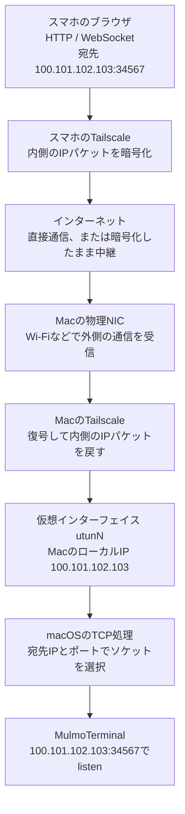
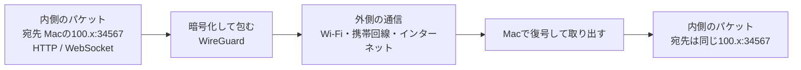
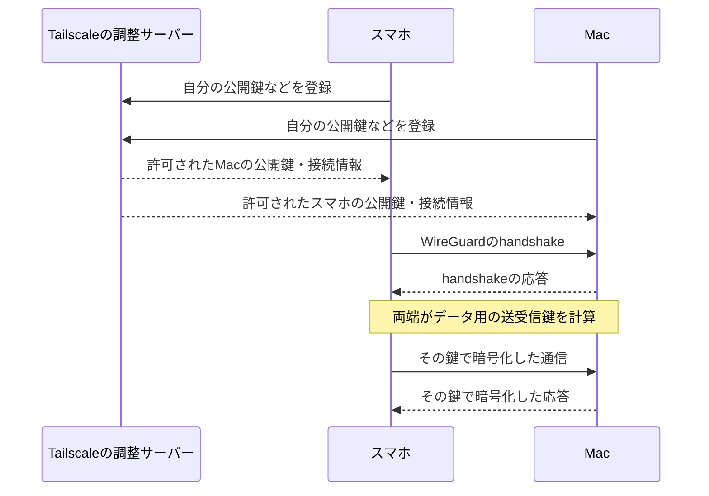
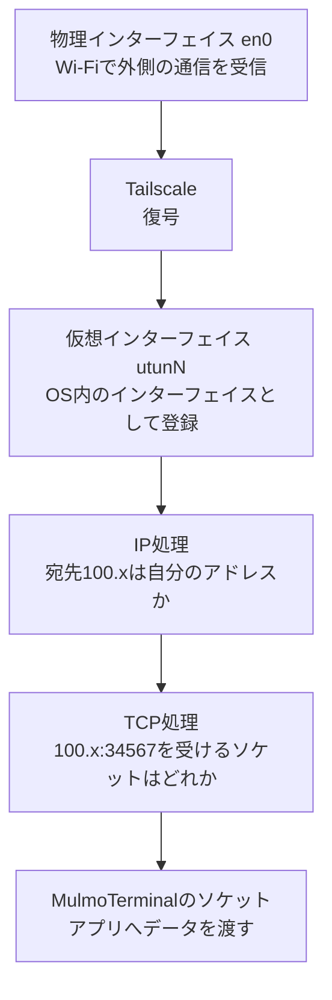
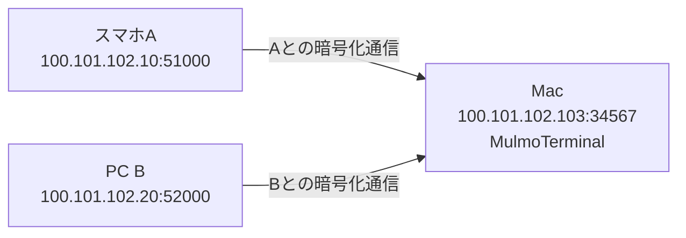
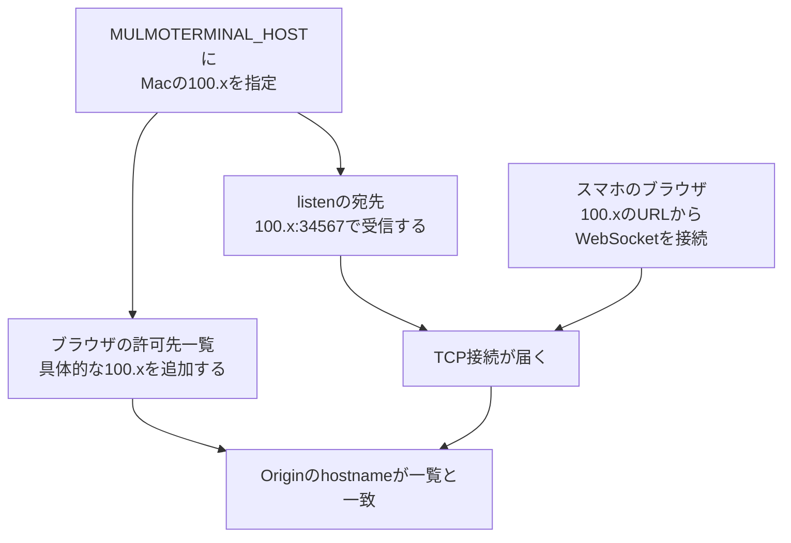

Macで動くMulmoTerminalを、外出先のスマホから開きたい。スマホとMacをTailscaleでつなぎ、MacのWeb UIを直接開く方法を調べました。Web UIは、ブラウザに表示する操作画面です。Tailscaleは離れた端末の間に、暗号化した通信経路を作るソフトウェアです。

最初に引っかかったのは、「MacのWi-Fiには192.168.x.xしか見えないのに、なぜTailscaleの100.x.x.xでアクセスできるのか」という点です。暗号を元に戻した通信がlocalhostへ転送されるのでしょうか。localhostは、そのプログラムが動いている端末自身を指す名前です。それなら、なぜMulmoTerminalの待ち受けアドレスを変える必要があるのでしょうか。

この通信を、スマホからMacのアプリへ届く順に追います。OSはmacOSやiOSのように、端末全体を管理するソフトウェアです。通信を受け取り、宛先のアプリへ渡すのもOSの仕事です。

:::message

MulmoTerminalのコードは[ae270ae7c8609b8f3c04d891241bce9a30f96a13](https://github.com/receptron/mulmoterminal/tree/ae270ae7c8609b8f3c04d891241bce9a30f96a13)に固定して確認しました。手元ではMacのutunインタフェースへのTailscale IP割り当てと、別端末からの接続を確認しています。スマホでの画面操作全体は未検証です。以下の100.101.102.103は説明用で、実際には自分のMacのアドレスを使います。

:::

## 宛先はMacの100.xのまま

スマホが`http://100.101.102.103:34567`を開くと、内側の通信の宛先は **100.101.102.103のTCPポート34567** です。TCPは、データの順序をそろえ、届かなかった分を送り直す通信方式です。ポート番号34567は、そのMacで動くMulmoTerminalの受け口を指定しています。

送信側のTailscaleが通信を暗号化し、MacのTailscaleが元に戻します。元に戻す操作を復号と呼びます。復号後の宛先も100.101.102.103:34567です。localhost用の127.0.0.1への書き換えは、この接続では行いません。

Macには、Tailscaleが使うソフトウェア上の通信出入口があります。これを仮想インタフェースと呼び、100.xが割り当てられています。MacのOSは、そのIP宛ての接続を受け付けられます。

アプリはOSに通信の受け口を用意してもらいます。この受け口がソケットです。接続を待つ状態にする操作をlistenと呼びます。MacのOSは受け取った接続を、宛先IPとポートが一致する、接続待ちのソケットへ渡します。

ブラウザはHTTPで画面やデータを取得します。WebSocketは接続を維持して双方向にデータを送る仕組みで、ターミナルの入力や出力をやり取りするために使われます。図中のHTTPとWebSocketはこの役割です。



スマホはMulmoServerを介さず、MacのWeb UIへ接続します。その通信を運ぶTailscaleは、端末同士で直接通信できない場合、中継サーバーを使います。

### パケットの「外側」と「内側」を分ける

パケットは、通信内容を小さく分け、宛先などの情報を付けたものです。VPNでは、このパケットを暗号化して、別の通信の中に包みます。これがカプセル化です。

ブラウザの通信を包む前と後で、宛先を見比べます。

```text
内側：スマホのTailscale IP:一時的なポート
      → MacのTailscale IP:34567
      内容はHTTPやWebSocketのデータ

外側：スマホとMacの間を、携帯回線やWi-Fi経由で運ぶ通信
      インターネット上の接続先のIPとポートを使う
      中身は暗号化された内側のパケット
```

外側のIPやポートは、使う回線や中継先によって変わります。ルーターがIPやポートを変換するNATの影響も受けます。Tailscaleはこの外側の接続先へ送り、MacのTailscaleは届いた中身を取り出します。ブラウザが指定した100.xは、内側の宛先として残ります。



MacのWi-Fiが外側の通信を受信します。MacのTailscaleが中身を復号し、取り出した内側のパケットをOSへ渡します。この受け渡しはMac内のソフトウェアで行うため、ネットワークカードを追加する必要はありません。

### 暗号化の鍵は、誰が渡しているのか

Tailscaleが端末間の暗号通信に使うのは、WireGuardというVPN方式です。IPsecもVPNを作る方式の1つです。

各端末は、自分だけが持つ秘密鍵と、相手へ知らせてよい公開鍵を持ちます。Tailscaleの調整サーバーは、通信相手の公開鍵と接続先を端末へ届けます。秘密鍵は端末に置いたままです。

次に端末同士が、暗号化通信を始めるためのやり取りをします。これがhandshakeです。WireGuardはNoiseという方式を使い、両端が持つ鍵と、そのやり取りのために作った一時的な鍵から、データの暗号化に使う鍵をそれぞれ計算します。

スマホとMacは公開してよい値を交換し、それぞれ自分の秘密の値と組み合わせて計算します。その結果、スマホの送信用の鍵とMacの受信用の鍵が対応します。**完成したデータ用の鍵を、相手へ送る必要はありません。**



この2段階をコードで確認します。Tailscaleの[controlclient/direct.go](https://github.com/tailscale/tailscale/blob/9a522a9786c97eb7910c01ccb7bd66557b04c910/control/controlclient/direct.go#L704-L762)は端末の鍵を作り、登録リクエストに公開鍵を設定します。WireGuard側の[CreateMessageInitiation](https://github.com/tailscale/wireguard-go/blob/417aef361226c869ab29e15fe3539b01173c4719/device/noise-protocol.go#L272-L335)は、handshake用の一時的な鍵を作り、公開値をメッセージへ入れ、鍵の計算を進めます。

データ用の鍵を作る[BeginSymmetricSession](https://github.com/tailscale/wireguard-go/blob/417aef361226c869ab29e15fe3539b01173c4719/device/noise-protocol.go#L627-L673)は、次の処理を実行します。インデントだけ整えた実コードです。

```go
KDF2(
    &sendKey,
    &recvKey,
    handshake.chainKey[:],
    nil,
)
```

`KDF2`は鍵を作る関数です。ここではhandshakeで得た`chainKey`を材料に、送信用の`sendKey`と受信用の`recvKey`を作ります。相手側では送受信の対応が逆になるように計算するため、一方が送信用の鍵で暗号化したデータを、もう一方が受信用の鍵で復号できます。

WireGuardは通信中のデータ用の鍵も更新します。これは、Tailscaleに登録した端末の鍵の更新とは別の処理です。調整サーバーは相手の公開鍵を知らせ、データ用の鍵は通信する端末同士で作ります。[WireGuard公式のプロトコル説明](https://www.wireguard.com/protocol/)

## 1枚のネットワークカードで、複数のIPを使う

ネットワークカードをNICと呼びます。物理NICは、電波やケーブルで通信する装置です。一方、OSが扱うネットワークインタフェースには、ソフトウェアで作られるものもあります。macOSの`lo0`にある127.0.0.1も、その一例です。

Tailscaleの場合は仮想インタフェースが加わります。確認したMacでは`utun9`にTailscaleの100.xがありました。番号は環境によって変わります。

```text
en0    : Wi-Fi側のIP（例：192.168.1.20）
lo0    : 127.0.0.1
utunN  : Tailscale側のIP（例：100.101.102.103）
```

上は説明に必要な3つを抜き出した例です。実際のMacには、ほかの通信出入口やIPv6アドレスもあります。

アプリがソケットを特定のIPとポートに結び付ける操作をbindと呼びます。**bindで指定するのは、OSが扱うその端末のIPとポートです。** そのため、物理NICに100.xが付いていなくても、仮想インタフェースの100.xで待ち受けられます。1つのインタフェースに複数のIPを設定できます。カードの枚数とIPの数は一致しません。

### Appleのドキュメントではどう説明されているか

Appleの[NEPacketTunnelProvider.packetFlow](https://developer.apple.com/documentation/networkextension/nepackettunnelprovider/packetflow)は、仮想インタフェースとVPNアプリの間でIPパケットを受け渡す仕組みを説明しています。VPNアプリはOSから送られたパケットを受け取り、受信時には逆にOSの通信処理へ戻します。[NEPacketTunnelFlow](https://developer.apple.com/documentation/networkextension/nepackettunnelflow)では、VPNアプリがReadでOSから送信パケットを読み、Writeで受信パケットをOSへ渡します。[NEIPv4Settings](https://developer.apple.com/documentation/networkextension/neipv4settings)には仮想インタフェースへ割り当てるIPv4アドレスの設定があります。

TailscaleのmacOS版には複数の配布形態があります。以下ではAppleのドキュメントと公開Goコードで仕組みを説明します。手元にインストールしたアプリの全コードを確認できたわけではありません。

### 仮想インタフェースの「実物」はOS内のデータ構造

OSは、仮想インタフェースの情報をメモリ上に持ちます。プログラムでは、このように情報をまとめたものをオブジェクトと呼びます。OSはそこへIPアドレスを設定し、どの宛先の通信を通すかを登録します。

macOSの中心で通信やメモリを管理する部分は、XNUという名前でコードが公開されています。このXNUには、utunを作る処理で`ifnet_allocate_extended`と`ifnet_attach`を使う[実装](https://github.com/apple-oss-distributions/xnu/blob/main/bsd/net/if_utun.c#L1825-L1845)があります。前者がインタフェースのオブジェクトを用意し、後者がOSへ登録する処理です。この2つの処理で、ソフトウェア上の通信出入口を使えるようにします。



公開されているTailscaleのBSD向けルーター実装には、仮想インタフェースへIPを付けるコマンドを組み立てる[コード](https://github.com/tailscale/tailscale/blob/9a522a9786c97eb7910c01ccb7bd66557b04c910/wgengine/router/osrouter/router_userspace_bsd.go#L121-L134)もあります。

```go
arg = []string{"ifconfig", r.tunname, inet(addr), addr.String(), addr.Addr().String()}
```

この行は、仮想インタフェース名とIPアドレスを指定してifconfigを実行するための引数を作ります。GUI版でAppleのAPIを呼び出す部分は未確認のため、手元のアプリがこのコマンドを実行したかは分かりません。手元で確認できたのは、utunに100.xが割り当てられていることです。

### 暗号化するコードと、OSへ戻すコード

Tailscale [v1.104.1のuserspace.go](https://github.com/tailscale/tailscale/blob/9a522a9786c97eb7910c01ccb7bd66557b04c910/wgengine/userspace.go#L480-L483)は、トンネル側とネットワーク通信側をWireGuardへ渡しています。

```go
e.wgdev = wgcfg.NewDevice(e.tundev, e.magicConn.Bind(), e.wgLogger.DeviceLogger)
```

ここで`e.tundev`がOSのIPパケットを扱う側、`e.magicConn.Bind()`が実際の通信経路を扱う側です。`NewDevice`は、その2つを使うWireGuardの処理を作ります。MulmoTerminalはHTTPやWebSocketを処理し、そのIPパケットをTailscale側のWireGuardが暗号化して送ります。

この版が依存する[wireguard-goの復号処理](https://github.com/tailscale/wireguard-go/blob/417aef361226c869ab29e15fe3539b01173c4719/device/receive.go#L221-L247)には、次の呼び出しがあります。改行だけ整えた抜粋です。

```go
elem.packet, err = elem.keypair.receive.Open(content[:0], nonce[:], content, nil)
```

`Open`は暗号化された内容を復号し、改ざんされていないかを確かめます。成功すると`elem.packet`に内側のパケットが入り、失敗するとエラーになります。

その後、再送された古いパケットでないか、送信元がその相手に許可されたIPかなどを検査し、[TUNへ書き込みます](https://github.com/tailscale/wireguard-go/blob/417aef361226c869ab29e15fe3539b01173c4719/device/receive.go#L416-L518)。TUNはOSとVPNプログラムの間でIPパケットを受け渡す仕組みです。

Tailscale側の[Wrapper.Write](https://github.com/tailscale/tailscale/blob/9a522a9786c97eb7910c01ccb7bd66557b04c910/net/tstun/wrap.go#L1258-L1316)にも、受信のフィルター処理を経て次の呼び出しがあります。

```go
return t.tdev.Write(buffs, offset)
```

ここでいうWriteは「インターネットへ送る」ではなく、**復号したパケットをOS側へ渡す向き**です。反対に、OSがVPNへ送ろうとしたパケットをVPN側がReadして暗号化します。

Appleの[utunの受信処理](https://github.com/apple-oss-distributions/xnu/blob/main/bsd/net/if_utun.c#L3078-L3095)には、パケットに受信インタフェースを設定し、OSの入力処理へ渡す経路があります。現代のXNUには別の高速化経路もあるため、実機が必ずこの関数順で動くとは断定しません。このコードでは、**復号されたIPパケットをOSのIP処理へ渡しています。**

Tailscaleには、用途によってアドレスを変換するコードもあります。この記事で追っているのは、Mac自身の100.xへ接続する場合です。この場合は100.x宛てのまま、Macのソケットへ届けられます。

## 復号後、どの待ち受けに届くのか

内側の宛先が100.101.102.103:34567の場合、IPv4の待ち受けを比べるとこうなります。

- `127.0.0.1:34567`：100.x宛てとは一致しない
- `100.101.102.103:34567`：その宛先と一致する
- `0.0.0.0:34567`：ローカルIPv4アドレスを限定しないワイルドカードなので、一致対象になる

`0.0.0.0`は接続先の実IPではありません。**待ち受けのローカルアドレス条件を限定しない指定**です。Appleの[inet(4)](https://github.com/apple-oss-distributions/xnu/blob/main/bsd/man/man4/inet.4)でも、INADDR_ANYのincoming wildcard matchingとして説明されています。

OSがソケットを選ぶ処理も確認できます。[XNUのIP入力処理](https://github.com/apple-oss-distributions/xnu/blob/main/bsd/netinet/ip_input.c#L1237-L1270)は、宛先IPをインタフェースのアドレス一覧と照合します。続く[TCP入力処理](https://github.com/apple-oss-distributions/xnu/blob/main/bsd/netinet/tcp_input.c#L2863-L2869)は送受信IP・ポートを使って接続情報を検索します。[ソケット検索](https://github.com/apple-oss-distributions/xnu/blob/main/bsd/netinet/in_pcb.c#L2408-L2510)には、具体的なローカルIPの一致と、次のワイルドカード判定があります。

```c
inp->inp_laddr.s_addr == INADDR_ANY
```

これは公開XNUの説明用参照で、手元のmacOSと同じソース版だという意味ではありません。OSは物理カードの枚数に関係なく、パケットの宛先IPとポートをソケットの条件に照合します。

したがって、Tailscaleをつないでも、アプリが127.0.0.1だけでlistenしていれば100.x宛ての接続は届きません。今回は100.xを明示して待ち受けます。Wi-Fi側まで一緒に受ける0.0.0.0を使う必要はありません。

## 同じMacに複数人がつなぐと、通信は混ざらないのか

Macは複数端末からの接続を受けられます。WireGuardは通信相手ごとに鍵や接続の状態を持つため、MacはスマホAとの通信とPC Bとの通信を同時に続けられます。

それぞれの端末には別のTailscale IPがあります。複数人が共用するのは、**アクセス先であるMacのIP**です。スマホAとPC Bは、それぞれ自分のIPから接続します。



MacのTCP処理は、「送信元IP・送信元ポート・宛先IP・宛先ポート」で接続を区別します。上の例では宛先は同じでも、送信元が違います。補足すると、この4つに通信方式のTCPを加えた5項目を「5-tuple」と呼びます。

WireGuardのコードにも、複数の通信相手を保存する一覧があります。[Deviceのpeer一覧](https://github.com/tailscale/wireguard-go/blob/417aef361226c869ab29e15fe3539b01173c4719/device/device.go#L59-L62)は公開鍵ごとに相手を管理し、[各Peer](https://github.com/tailscale/wireguard-go/blob/417aef361226c869ab29e15fe3539b01173c4719/device/peer.go#L35-L42)が鍵とhandshakeの状態を持ちます。

MulmoTerminalのWeb UIには独自の利用者認証がありません。複数人を接続させても、人ごとに操作権限を分けてくれるわけではありません。そのため、この記事では自分の端末からの利用を扱います。

## MulmoTerminalの設定は、何を変えるのか

起動するプログラムへ設定値を渡す**環境変数`MULMOTERMINAL_HOST`** を使います。コマンドの後ろに付ける`--host`のようなフラグとは、指定方法が違います。

[server/config/env.ts の71行目](https://github.com/receptron/mulmoterminal/blob/ae270ae7c8609b8f3c04d891241bce9a30f96a13/server/config/env.ts#L71)ではこう読まれます。

```ts
export const BIND_HOST = process.env.MULMOTERMINAL_HOST || "127.0.0.1";
```

`process.env`が起動時の環境変数を読みます。右側の127.0.0.1は値が指定されなかったときのデフォルト値です。指定すると、その値が[server/index.tsのlisten](https://github.com/receptron/mulmoterminal/blob/ae270ae7c8609b8f3c04d891241bce9a30f96a13/server/index.ts#L525)に渡ります。

```ts
server.listen(Number(PORT), BIND_HOST, () => onListening({ server, loopbackServers, browserHostnames }));
```

この設定で、MulmoTerminalのHTTPサーバーは100.xで接続を待つようになります。Tailscaleが100.x宛ての通信をMacへ運び、MacのOSがこのサーバーへ渡します。

### IPでつながっても、ブラウザの操作が拒否される問題があった

Macのサーバーへ接続できても、MulmoTerminalがブラウザの操作を拒否する場合があります。

MulmoTerminalは、ブラウザが送るOriginという情報を確認します。Originには、操作元のWebページのURLのうち、httpなどの通信方式、ホスト名、ポートが入ります。悪意ある別サイトを開いたブラウザから、手元のターミナルを操作されることを防ぐためのチェックです。ブラウザが100.xのWeb UIからWebSocketを開くと、Originにもその100.xが入ります。

[PR #964](https://github.com/receptron/mulmoterminal/pull/964)は、**すでに存在していた特定アドレスへのbindと、許可するブラウザOriginを連動させる修正**です。修正前は待ち受けを広げてもOriginがlocalhost系に限定され、ページは開けるのにターミナルへ接続できませんでした。

[PR内の修正commit](https://github.com/receptron/mulmoterminal/commit/66d385fc6ac6fabf6498fd91cc15faa38531d713)の要点は次の差分です。

```diff
- return LOOPBACK_HOSTNAMES.has(new URL(origin).hostname);
+ const { hostname } = new URL(origin);
+ return LOOPBACK_HOSTNAMES.has(hostname) || browserHostnames.has(hostname);
```

修正前は、Originのホスト名がlocalhostや127.0.0.1などの一覧に入っているかだけを調べていました。修正後は、そこにない場合でも`browserHostnames`の一覧を調べ、どちらかに入っていれば許可します。

追加する`browserHostnames`は、設定した具体的なbindアドレスと、明示した追加許可先から作られます。[現行確認コードの70〜78行目](https://github.com/receptron/mulmoterminal/blob/ae270ae7c8609b8f3c04d891241bce9a30f96a13/server/infra/http/allowed-origin.ts#L70-L78)にある中心部分です。

```ts
const bind = hostnameOf(bindHost);
const fromBind = bind !== null && !WILDCARD_BIND_HOSTNAMES.has(bind) && !LOOPBACK_HOSTNAMES.has(bind) ? [bind] : [];
```

この行は、設定値が有効で、ワイルドカードとloopbackのどちらにも当てはまらないときに、その名前を1件の追加候補として返します。100.xを具体的に指定すると、そのアドレスが許可対象に入ります。0.0.0.0のようなワイルドカードからはブラウザで開く名前を決められないので、自動追加しません。IPの代わりにDNSの名前で開く場合などは、`MULMOTERMINAL_ALLOWED_ORIGINS`にその名前を指定します。

コードが照合するのはURLの**hostname**、つまりIPアドレスやドメイン名の部分です。http/httpsの違いやポート番号までは照合しません。リクエストが持ってきた宛先のHost情報から、許可先を勝手に追加することもありません。



### Originチェックは本人認証ではない

ブラウザのOrigin制約と違い、curlなどはOriginヘッダーを自分で設定できます。MulmoTerminal自身も[起動警告](https://github.com/receptron/mulmoterminal/blob/ae270ae7c8609b8f3c04d891241bce9a30f96a13/server/infra/http/allowed-origin.ts#L117-L126)で「到達できる人はセッションを読み、ターミナルを起動できる」と説明しています。

確認する設定は3つあります。

- bind：MacのどのIPで接続を待つか
- Origin：どのWebページからのブラウザ操作を許可するか
- Tailscaleのアクセス制御：どの端末・利用者がMacの34567番ポートへ接続できるか

**自分のスマホだけに使わせるなら、Tailscaleのアクセス制御でMacの34567番ポートへの許可先を確認します。**

ほかの人の端末にも接続を許可すると、その人もターミナルを操作できるおそれがあります。

### Mac内の処理用に、localhostでも接続を待つ

確認したコードには、PR964の後に加わった、Mac内のプログラムからの接続を保つ処理もあります。[loopback-listener.ts](https://github.com/receptron/mulmoterminal/blob/ae270ae7c8609b8f3c04d891241bce9a30f96a13/server/infra/http/loopback-listener.ts#L1-L24)は、同じMac内のプログラムからサーバーへの連絡を保ちます。100.xなどのloopback以外を指定したときにも、127.0.0.1と::1で接続の受け口を作ります。Claudeの処理から通知するhooksや、ツールを呼び出すMCPが、この接続を使います。::1はIPv6で自分の端末を指すアドレスです。

そのため100.xを指定しても、待ち受けを調べるlsofコマンドに127.0.0.1や::1が一緒に表示される場合があります。自分の端末内で完結するこの接続をloopbackと呼びます。100.x用とは**別のlistenソケット**があるためです。100.x宛ての通信は100.x用へ、127.0.0.1宛ての通信は127.0.0.1用へ届きます。

## 起動と確認

MacとスマホのTailscaleを有効にし、両端末間の通信が許可されていることを確認します。MacのTailscaleアプリで、そのMacのIPv4を調べます。コマンドでTailscaleを操作できる環境なら`tailscale ip -4`でも確認できます。

既存のMulmoTerminalが起動している場合は、作業を保存し、通常の終了手順で止めてから設定付きで起動します。環境変数は起動時に読み込まれるため、すでに動いているプロセスの設定は変わりません。

```bash
# 例のIPを、自分のMacのTailscale IPv4へ置き換える
MULMOTERMINAL_HOST=100.101.102.103 npx mulmoterminal@latest
```

`npx ...@latest`は[公式READMEの起動方法](https://github.com/receptron/mulmoterminal/blob/ae270ae7c8609b8f3c04d891241bce9a30f96a13/README.md#L308-L325)に合わせています。このコマンドは実行時点の最新版を起動します。この記事で読んだコードから変更されている場合があるので、利用する版の起動条件や設定も確認してください。

Macで次を確認します。どちらも設定変更はしません。

```bash
# utun系にMacのTailscale IPがあるか
ifconfig

# プロセスと待ち受けアドレスを確認する
lsof -nP -iTCP:34567 -sTCP:LISTEN
```

期待するのは、MulmoTerminalのプロセスが100.101.102.103:34567でlistenしていることです。Mac内の接続用に127.0.0.1や::1が出ることもあります。

次にスマホのブラウザで開きます。

```text
http://100.101.102.103:34567
```

読み取り用の到達確認なら、Tailscaleに接続した別のPCから次を実行できます。

```bash
curl --noproxy '*' --connect-timeout 5 -I http://100.101.102.103:34567/
```

HTTPの応答が返れば、別のPCからサーバーへ接続できています。このコマンドはヘッダーだけを取得するため、WebSocketのOriginチェックやスマホでの操作は確認できません。画面が開くのに接続中のままなら、起動時の許可先表示とWebSocket拒否ログを確認します。最初から応答がなければ、Macのスリープ、両端のVPN接続、宛先IP、listen、アクセス制御の順に切り分けます。

## HTTPのままでも、どこが暗号化されるのか

HTTPやWebSocketの内容は、Tailscaleの端末間トンネルを通る間は暗号化されます。直接接続できず中継される場合も、端末間の暗号化は維持されます。[公式の通信経路説明](https://tailscale.com/docs/concepts/traffic-routing-through-tailscale)

ブラウザから見るURLはHTTPのままです。Tailscaleが暗号化していても、ブラウザはそのページをHTTPSとして扱いません。HTTPSなどの条件を満たすページでしか使えない機能（secure contextを要求する機能）には、この違いが影響します。

Macのアプリは復号した内容を読み取ります。アプリが履歴を保存したり、AIサービスへ送信したりする処理も、Tailscaleによって止まるわけではありません。保存先や送信先はアプリ側で確認します。

## MulmoServer経由との使い分け

[Remote Hostの仕様](https://github.com/receptron/mulmoterminal/blob/ae270ae7c8609b8f3c04d891241bce9a30f96a13/docs/remote-host-protocol.md#transport)では、Mac側がFirebaseでサインインし、利用者ごとの指示がFirestoreに届くのを待ちます。指示が届くとMac側で処理し、結果を返します。端末へ外から直接接続できない環境でも、サインインした利用者の指示を受け取り、処理結果を後から返せます。一方、今回のWeb UIへのHTTP/WebSocket経路にはそのコマンド中継が不要になります。Remote Hostなどを別に有効にしていれば、その機能の通信や保存は続きます。直接接続したことだけを根拠に、Firestoreへの記録がすべてなくなるとは言えません。

## まとめ

Tailscaleの100.xは、Macの仮想インタフェースに割り当てられたIPです。MacのTailscaleが通信を復号し、OSが宛先100.xとポート番号に合うソケットへ渡します。

MulmoTerminalは、`MULMOTERMINAL_HOST`に指定した100.xで接続を待ちます。PR964の修正により、その100.xで開いたページからのブラウザ操作も許可します。この2つがそろうことで、Tailscale経由でWeb UIを開いて操作できます。利用するときは、Macの34567番ポートへの接続許可を必要な端末に絞ります。

---

コード参照：MulmoTerminalは本文記載の固定commit、Tailscaleは公開版v1.104.1の固定commit、wireguard-goはその依存commitを用いました。WireGuardの抜粋はWireGuard LLCのMITライセンス実装、Tailscaleの公開Go実装はBSD-3-Clauseです。XNUはリンク先の公開コードの説明であり、実機macOSと同一版であることは確認していません。
