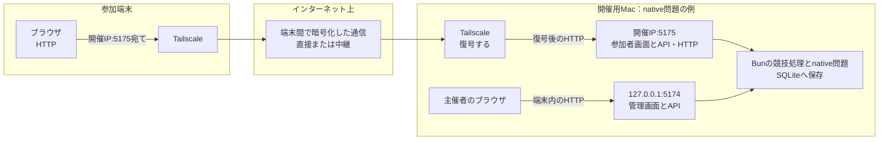
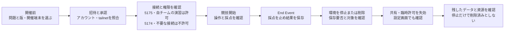
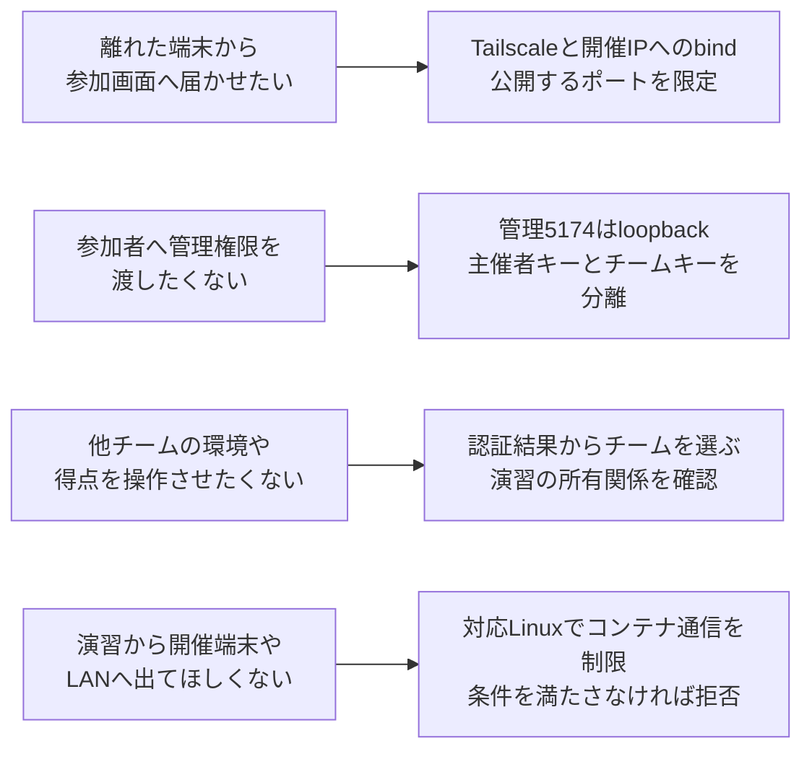
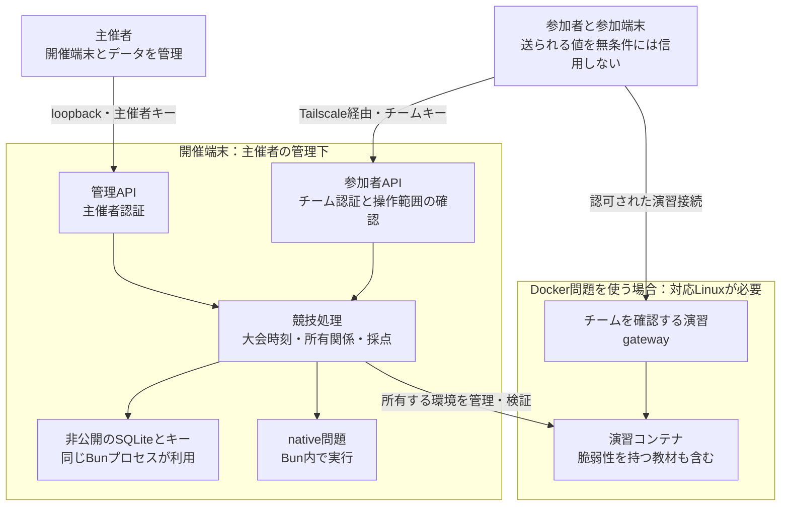
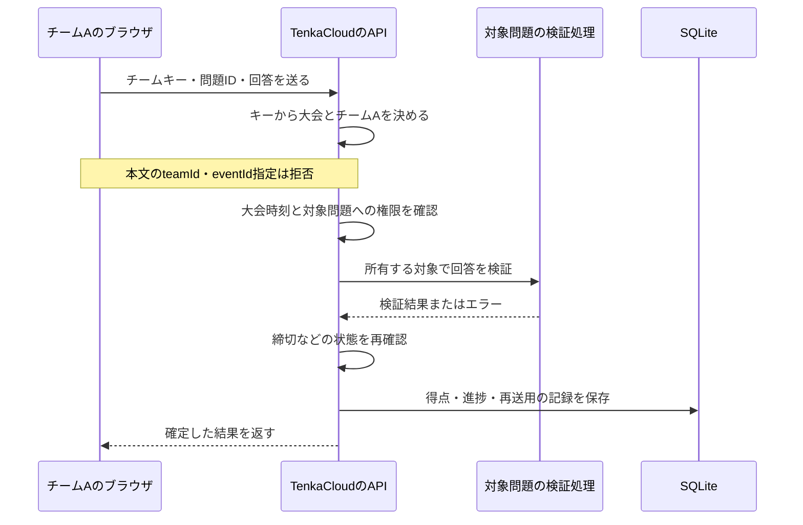
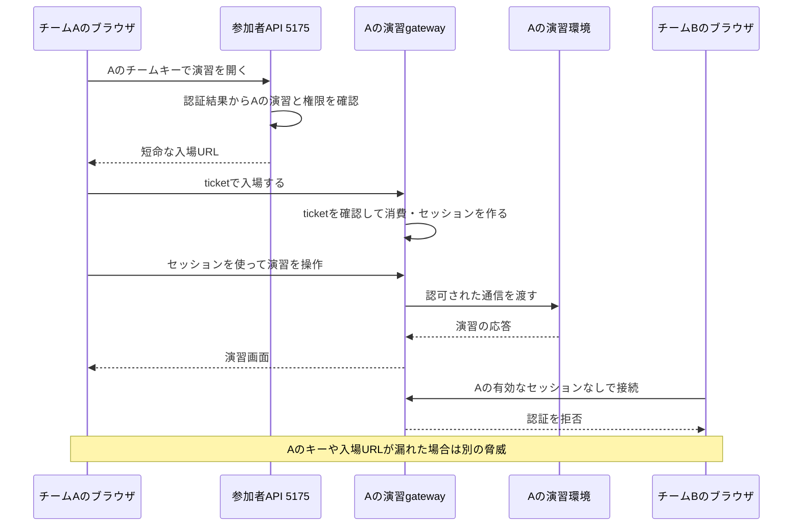
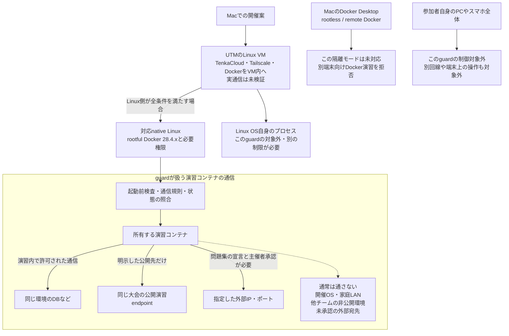

## この記事で試すこと

離れたPCから、主催者のTenkaCloudへ参加するところまで試したい人向けの記事です。前半では**主催者用と参加者用の2台を同じtailnetにつなぎ、暗号バトルを開始・採点・終了する**手順を追います。

- 到達点は、参加端末から自分のチームへログインし、問題の操作と得点を確認して、開催後の接続許可を片づける。
- 準備するものは、主催者はMacまたはLinuxの専用環境と、ソフトウェアを導入できる権限を用意する。参加者はPCのブラウザを使う。Tailscaleの管理者が招待とアクセス制御を確認できることも必要。
- 扱うのは、DockerとAWSが不要なCrypto Battle（暗号バトル）。他人の得点を奪うScore Stealは使わない。

[Tailscale](https://tailscale.com/docs/how-to/quickstart)は、許可した端末同士を暗号化した通信でつなぐサービスです。tailnetは、その利用者と端末をまとめるプライベートなネットワークです。IPは、通信先を表す住所のような番号です。

Dockerは、プログラムをコンテナという実行環境へ分けて動かす仕組みです。今回の最初の手順には不要です。

:::message

これは開催準備の手順で、実測による成功報告ではありません。2026年10月20日にTenkaCloudのmain、[d1c77b00f5b7eefc99021741a78ae23ecd9031ab](https://github.com/susumutomita/TenkaCloud/tree/d1c77b00f5b7eefc99021741a78ae23ecd9031ab)を再確認しました。公式[ガイド](https://tenkacloud.com/docs/getting-started/)はPreviewです。今回、Tailscale経由のTenkaCloud開催、スマホ、多人数、UTM、Dockerの実通信は検証していません。

:::

外部参加者への端末共有とDocker問題は、最初の手順を終えた後の「構成を広げる場合」で扱います。安全性の仕組みを読みたい場合は、その後のコード解説へ進めます。

## TenkaCloudと、遠隔開催を作った理由

[TenkaCloud](https://github.com/susumutomita/TenkaCloud)は、クラウドやセキュリティの課題に、実際に手を動かして取り組むために作っているOSSです。OSSは、コードを公開し、ライセンスの条件に沿って利用・改良できるソフトウェアです。参加者はチームで問題に取り組み、得点を競います。

主催者は、大会・チーム・問題の実行環境・採点結果・順位を1つの画面で管理できます。参加者にはチームキーを配るため、全員がTenkaCloud本体をインストールする必要はありません。問題集を追加して再利用できます。[紹介ページ](https://tenkacloud.com/)に概要をまとめています。

紹介する中で、コミュニティや研究室で使ってみたいと言ってもらいました。一方で、クラウド費用や、いくら課金されるか分からない不安が利用の壁になっていました。[以前の記事](https://zenn.dev/singularity/articles/singularity-society-bootcamp-4months)でも、利用者の声を受けて費用の考え方が変わったことを書いています。

そこで、AWS上で開く大会に加え、主催者のローカルPCで開ける競技モードを追加しました。暗号バトルのようにクラウド資源を使わない問題なら、クラウドの利用料を発生させずに競技できます。問題ごとの対応方式や、Tailscaleの利用条件・料金は別に確認します。

さらに、地理的に離れた人にも参加してもらうため、Tailscaleを接続に使いました。VPNは、離れた端末の間に仮想的な通信経路を作る仕組みです。自分でVPNを作るのではなく、Tailscaleが届けた通信をTenkaCloudで受け付けます。

ただし、自分のPCへ参加者を受け入れると、管理画面の悪用や他チームへの接続も考える必要があります。家庭LANという、家庭内のPC・機器がつながるネットワークも守りたいところです。特に苦労した問題コンテナからの通信制限は、後半で実装と限界を説明します。

## 最初に、2台の役割と通信を見る

ソフトウェアを動かすPCを「開催端末」、参加者がブラウザを使うPCを「参加端末」と呼びます。以下は開催端末をMacにした例です。Linuxでも役割は同じです。

この図のnative問題は、Dockerを使わずBun内で動く問題です。Bunはプログラムを動かす道具です。

TCPはデータを順序どおりに届ける通信方式、ポートは端末内の接続先を区別する番号です。HTTPはWebの通信方式です。APIは画面の操作をプログラムへ伝える窓口です。SQLiteは得点などを保存するデータベースです。


図の5175が参加者の入口です。5174は開催端末上の主催者だけが使います。この端末内だけの接続をloopbackと呼びます。127.0.0.1は、操作している端末自身を指すアドレスです。参加者へ主催者の画面を中継しません。

Tailscaleの暗号化やMacの受信処理の基礎は、[MulmoTerminalの記事](https://zenn.dev/susumutomita/articles/tailscale-mulmoterminal-network)につなぎます。そちらの実機確認はMacからMacへのMulmoTerminal接続で、TenkaCloudやスマホの確認結果ではありません。

## 2台で暗号バトルを開く

### 1. 開催前の条件をそろえる

**普段の個人ファイルや秘密を置かない、専用の開催環境を使います。** 会社の端末なら、所有者・管理者の承認も必要です。参加者に開催OSの管理権限を渡しません。OSは、端末を動かす基本のソフトウェアです。

今回使うnative問題は、Dockerの演習コンテナを使わずBun内で動く問題です。**問題コードをOSから隔離する機能ではありません。** 信頼できる教材だけを選び、未知のコードやマルウェアを試す場所にはしません。マルウェアは、情報を盗むなどの悪意ある動作をするソフトウェアです。

開催端末にGit・Make・Bun 1.3.11とインターネット接続を用意します。Gitはコードの版を管理し、Makeは用意された作業を呼び出す道具です。導入方法は[公式ガイド](https://tenkacloud.com/docs/getting-started/#local-start)を確認します。

Tailscaleの設定を扱う管理者を決めます。この後で、参加者向けは5175だけを許可し、5174と不要なサービスを許可しないことを、有効な設定全体で確認します。専用サーバーやMac上の仮想マシンを使う場合の追加条件は、後半にまとめています。

### 2. 同じtailnetへ2台を登録する

両方のPCへ[公式手順](https://tailscale.com/docs/how-to/quickstart)でTailscaleを導入します。Macは[macOS向け手順](https://tailscale.com/docs/install/mac)に従います。OSがVPN構成の許可を求めたら、公式手順に沿って進めます。

1. 主催者が、参加者を開催用tailnetへ招待します。[利用者招待の公式案内](https://tailscale.com/docs/manage-users)から、利用する認証方法に合う手順を選びます。自分の2台で先に試すなら、同じアカウントで登録できます。他人とログイン情報を共用しません。
2. 参加者は招待を受け、決めたアカウントでログインします。ブラウザとTailscaleアプリで、選択中のアカウント・tailnetが一致するか確認します。
3. 利用者承認や端末承認が有効なら、管理者の承認を待ちます。Machinesの`Needs approval`は、グループ追加では解消しません。[端末管理の公式手順](https://tailscale.com/docs/features/access-control/device-management/how-to/set-up)も確認します。
4. 管理者は端末一覧で開催端末と参加端末を照合します。参加者が管理画面を開けない役割なら、管理者が確認します。

### 3. 参加者の5175への接続だけを許可する

アクセス制御は「誰が、どの端末の、どのポートへつなげるか」を決める設定です。policyはアクセス制御の設定で、grantsやACLはその書式です。ここでは通信の許可にgrantsを使います。[公式のgrants説明](https://tailscale.com/docs/features/access-control/grants)は “deny-by-default” と表現しています。必要な通信を明示して許可する考え方です。ただし、実際のtailnetに広い許可が残っていないかは別途確認します。

この手順では、管理者が`group:event-participants`のような参加者グループを用意し、承認した本人の識別子を追加します。[公式のグループ仕様](https://tailscale.com/docs/reference/syntax/policy-file#groups)を確認し、policyファイルの`groups`、またはUsers → 対象者の`…` → `Edit group membership`で操作します。グループ編集の権限も必要です。これは端末登録やTenkaCloudのチーム作成ではありません。

以下は、**同じtailnetで暗号バトルを試す場合の設定例**です。既存policyを丸ごと置き換えるものではありません。管理者が他の許可との関係を確認し、設定の検査・テストを通してから適用します。メールアドレスとIPは架空の値です。IPは開催端末自身のものへ置き換えます。

```json
{
  "groups": {
    "group:event-participants": ["student@example.com"]
  },
  "hosts": {
    "event-host": "100.96.12.34"
  },
  "grants": [
    {
      "src": ["group:event-participants"],
      "dst": ["event-host"],
      "ip": ["tcp:5175"]
    }
  ]
}
```

`src`は接続する人、`dst`は接続先、`ip`は許可する通信方式とポートです。`hosts`はpolicy内で使うIPの別名で、ブラウザで接続先を名前で開けるようにする設定ではありません。ログイン方法によって利用者識別子が異なるため、メールアドレスと決めつけず、管理画面と[公式の利用者表記](https://tailscale.com/docs/reference/syntax/policy-file#users)を照合します。

参加者へ許可するのは、開催端末のTCP 5175です。管理画面の5174や、遠隔操作に使うSSHなどの不要なサービスは許可しません。

**狭い許可を追加しても、既存の広い許可は打ち消されません。** 管理者は有効なpolicy全体を確認します。許可した参加者の5175は許可、5174・不要なサービス・許可していない利用者は不許可になることを、policyテストで確認します。会社の設定を本記事の例だけで置き換えないでください。

### 4. 開催端末でTenkaCloudを起動する

次は、新しい開催用ディレクトリで行う準備です。稼働中の大会を途中で更新・再起動する手順ではありません。

commitは記録した変更の版で、次の長い英数字はその識別子です。本体を説明と同じ版へ固定します。

```sh
git clone https://github.com/susumutomita/TenkaCloud.git
cd TenkaCloud
# 本文で確認したコードに固定する
git checkout --detach d1c77b00f5b7eefc99021741a78ae23ecd9031ab
make install
```

`make local`は問題集も取得します。問題集は本体と別の版なので、取得した版も記録します。詳しくは後半の「再現するときに固定するもの」を確認します。

開催端末でTailscaleを有効にし、アプリの端末情報、またはCLIの`tailscale ip -4`と`tailscale status`で、自分のTailscale IPv4を確認します。CLIは文字で命令を入力する操作方法です。Macで`tailscale`が見つからない場合は、アプリの表示と公式の導入手順を使って確認します。

次の`100.96.12.34`は、TenkaCloudのガイドと同じ**説明用の値**です。実際には開催端末自身のIPへ置き換えます。参加者自身のIPを指定しません。

```sh
make local LOCAL_ARGS="--lan 100.96.12.34 --unsafe-lan"
```

このコマンドは、Tailscaleの導入、招待、アクセス制御、OSの通信許可を設定しません。`--unsafe-lan`はHTTPでの待ち受けに明示的に同意する指定です。TLSは通信を暗号化する仕組みです。この指定だけでVPNやTLSが有効になることはありません。

初回はbuildを省略しません。ソースコードは動作を記述した文章、buildはそこから実行用のファイルを作る処理です。起動ログに表示されたURLを確認します。デフォルトのポートなら、主催者は**開催端末上で**`http://127.0.0.1:5174`を開きます。

対話ターミナルでの起動時に表示される主催者キーを非公開で保管し、主催者のログインに使います。起動し直すと以前の主催者キーとログインは失効します。主催者キーを参加者へ配りません。管理画面を参加者用に転送・proxyしないでください。proxyは、別のサービスへ通信を中継する仕組みです。

### 5. 暗号バトルに参加し、得点を確かめる

主催者はHost Console（主催者画面）で大会を作り、最初は参加用の1チームを用意します。問題はCrypto Battle（暗号バトル、IDは`crypto-battle`）だけを選び、Score Stealが無効のnative構成であることを確認します。画面の作成・開始手順は[開催者マニュアル](https://tenkacloud.com/docs/manual/organizer/)を確認します。

大会のSchedule（スケジュール）で、画面の案内に沿って開催準備を完了します。準備できたことを確認してから、各チームへそのチームのキーだけを渡します。

参加者へ渡すのは、起動ログの参加者URL、チームキー、接続先の開催端末名です。例は`http://100.96.12.34:5175/`です。参加端末で127.0.0.1を開くと、開催端末へは届きません。このLAN構成はIPに基づくHost（接続先）とOrigin（ブラウザの操作元）を検査するため、URLを勝手にMagicDNS名へ置き換えません。MagicDNSは端末を名前で探すTailscaleの機能です。

参加者はTailscaleが接続中で、招待を受けたアカウント・tailnetになっていることを再確認してから、URLを開きます。PCでは、承認済みの開催端末だけを次のように確認できます。ここでもIPを置き換えます。

```sh
EVENT_HOST_IP=100.96.12.34
curl --fail "http://${EVENT_HOST_IP}:5175/healthz"
nc -vz -w 3 "$EVENT_HOST_IP" 5175
nc -vz -w 3 "$EVENT_HOST_IP" 5174
```

確認するのは、healthの`status`が`ok`で`role`が`participant`、5175へ接続でき、5174へ接続できないことです。`curl`はHTTPの応答、`nc`はポートへの接続を調べるコマンドです。

5174への接続失敗だけでは、Tailscaleの制御が正しい証明にはなりません。アプリが外向けに待ち受けていないだけでも失敗します。管理者のpolicyテストと組み合わせます。healthが開くことも、チームキー認証や採点まで動く証明にはなりません。

参加者はチームキーでログインし、自分のチーム名と暗号バトルが表示されることを確認します。

主催者はログインできたことを聞いてから、Scheduleで大会を開始します。参加者は問題の案内に沿って操作し、主催者と参加者の画面で得点を照合します。ここが手順の到達点で、接続確認だけで採点も成功したことにはしません。

暗号バトルは競技中の操作で得点が変わります。問題の遊び方は画面の案内と[参加者マニュアル](https://tenkacloud.com/docs/manual/participant/)を参照します。ここでは実測の得点や所要時間を示しません。

### 6. 採点を止め、接続許可を片づける

End Event（大会終了）で採点を止め、必要な結果を保存します。開催端末の停止は別の操作です。[停止手順](https://tenkacloud.com/docs/getting-started/)に沿い、同じリポジトリの別ターミナルで次を実行します。

```sh
make down
```

これはDB・得点・キーを保持して停止します。独自の`--data`で起動した場合、停止時も同じ値が必要です。データを削除する手順ではありません。

管理者が開催用グループの所属や臨時の許可を片づけ、参加者の接続許可が残っていないことを確認します。ほかの用途でも使う利用者や端末を、まとめて削除しません。

開催端末を停止しただけでは、接続許可を取り消したことにはなりません。設定画面で失効を確認し、再接続できないことは補助確認にします。

次の図は、[ローカル停止・再開の設計図](https://github.com/susumutomita/TenkaCloud/blob/d1c77b00f5b7eefc99021741a78ae23ecd9031ab/docs/architecture/diagrams/local-play-sequence.mmd)を基に、安全確認の区切りを足したものです。採点終了、実行環境の停止・削除、ネットワーク上の招待失効は、別々に確認します。



## 構成を広げる場合

ここからは、最初の2台の手順とは別の構成です。共有先や問題を変える前に、追加条件を確認します。

### 外部のtailnetへ、開催端末1台を共有する

外部の参加者へ開催端末1台を共有する方法です。[共有の公式仕様](https://tailscale.com/docs/features/sharing)は範囲を “only the shared machine” と説明しています。「共有された端末だけ」という意味です。主催者のtailnet全体へ加入する手順ではありません。

1. 共有を作る主催者と、受け取る参加者は、それぞれのtailnetでOwner/Admin/IT adminのいずれかの権限が必要です。権限がなければ、それぞれの管理者に確認します。
2. 主催者はMachinesで開催端末を選び、`Share` → `Copy invite link` → `Copy share link`から、参加者ごとの単発リンクを作ります。`Reusable link`は有効にしません。招待リンクは本人にだけ渡します。
3. 参加者は招待を開き、ブラウザで受け取るアカウント・tailnetを確認して承認します。Tailscaleアプリでも、その共有を受けたアカウント・tailnetを選び、`Connected`を確認します。
4. 参加者は端末一覧から、主催者の伝えた開催端末を探します。共有は受諾した本人向けです。参加者側のtailnetにいる全員が自動的に使えるわけではありません。

共有を承認しても、ポートの許可は次の手順で確認します。共有時のIP競合で、受信側に別のIPを割り当てる場合があります。その場合は本記事のIP指定の手順を止め、両側の管理者と経路を確認します。

共有の受諾、同じtailnetへの参加、グループへの追加は別の操作です。[公式の共有とアクセス制御](https://tailscale.com/docs/features/sharing#sharing-and-access-control-policies)に沿い、開催側では受諾した外部利用者を`src`に指定します。参加側のグループが開催側へ引き継がれる前提にはしません。両側の管理者が有効なpolicyを確認します。

終了時は、開催端末のShare画面から対象者と未使用招待の`Revoke invite`を実行し、失効を確認します。スマホでもOS向けの公式手順が必要ですが、今回のTenkaCloudでの操作は未検証です。

### Docker問題では、接続先と隔離条件を追加する

Docker問題では、対応Linuxのguardという通信を検査する仕組みが必要です。後半で、その規則とDNS転送の制限を確認します。

Docker問題では、gatewayという演習環境への入口を使う場合があります。参加者画面の5175に加え、使うgatewayのTCPポートも許可します。`--gateway-ports`のデフォルトは5200–5239です。範囲全体が常時応答するわけではなく、画面から発行された自チームのURLで確認します。5174やコンテナ内部へ直接つながるポートは許可しません。

Docker環境を停止して残す場合は、Stop (keep data)を使います。Teardownや`local-clear`は削除を伴うため、対象と保存要否を先に確認します。大会終了、停止、削除を同じ操作と考えないでください。

| 使いたいもの | 開催端末の条件 | 参加者に必要な接続先 |
| --- | --- | --- |
| Dockerを使わないnative問題 | MacまたはLinux。ここではこの構成から始める | TCP 5175 |
| Docker / Compose問題 | 対応するnative Linuxと専用隔離モードが必要 | TCP 5175と、使用する演習gatewayのTCPポート |

**MacでTailscaleを使えることと、MacでDocker演習を隔離できることは別です。**

現行の隔離モードはnative Linux上のrootful Docker Engine 28.4.xに限られます。rootfulは、Dockerの管理プログラムが管理者権限で動く方式です。MacのDocker Desktop、rootless方式、別端末のDockerを使うremote方式は対象外です。詳しい拒否条件は後半で確認します。

### 専用サーバーやMac上のLinux VMを使う

実際の開催には、専用のクラウドサーバーか、Mac上の[UTM](https://mac.getutm.app/)で用意するLinux VMなどを勧めます。UTMは、Macで別のOSを動かすソフトウェアです。VMは、その仮想的なコンピューターを指します。個人ファイルや普段の仕事の権限を持つPCへ、演習の操作を直接受け入れる範囲を減らすためです。クラウドサーバーには利用料が発生します。手元でクラウド資源を使わない問題を動かす選択とは、費用の条件が違います。

VMにしただけで、元のMacや周囲の機器へ接続できなくなるとは限りません。[UTMのネットワーク説明](https://docs.getutm.app/settings-qemu/devices/network/network/)では、Shared NetworkでVMと元の端末のサービスが互いに見える構成を説明しています。NATも、通信の宛先・送信元アドレスを変換する仕組みで、家庭内LANへの接続を一律に禁止する機能ではありません。

開催用の環境を作るときは、次の点も別に確認します。

- [UTMの共有機能](https://docs.getutm.app/settings-qemu/sharing/)による共有フォルダとクリップボード同期は、不要なら無効にする。使う場合も教材で必要な範囲だけを選び、個人ファイルや秘密を共有しない。
- 開催用のOSに普段のAWSキーや秘密鍵を置かない。参加者へ開催OSやDockerの管理権限を渡さない。[Dockerの安全性の説明](https://docs.docker.com/engine/security/)も、Docker daemonを操作する権限を強い権限として扱っている。
- 後半で説明するTenkaCloudのguardにより、問題コンテナから開催OSや家庭LANへの通信を制限する。その外側の開催OS自身から出る通信は別に制限し、必要な接続を残して許可・拒否を確認する。

Linux VMを使う場合、TenkaCloudをそのLinux内で動かし、[Linux向け手順](https://tailscale.com/docs/install/linux)でTailscaleも同じVMへ導入します。指定するIPはVM自身のものです。管理画面の127.0.0.1もVMやクラウドサーバー自身を指します。主催者だけの管理経路を使い、参加者用に管理画面を公開しません。

Docker問題を選ぶ場合はDockerも同じLinux内へ導入します。演習の隔離を使うには、VM内でも後半のguardの条件をすべて満たす必要があります。native Linux、rootful Docker Engine 28.4.x、同じネットワーク名前空間、必要なfirewall権限などが条件です。MacのDocker Desktopを使う構成とは異なります。UTMでLinuxを起動できることだけを理由に、対応済みとは判断しません。

今回、UTM上のTenkaCloudとクラウドサーバーでの開催は実機未検証です。ここでは構成の候補と確認事項を示しています。OSや仮想化ソフトウェアの欠陥まで防げると保証するものではありません。

## なぜ、接続方法だけでなく競技用の境界を作るのか

### 出発点は「個人練習を共有」ではなく「別端末でチーム競技」

[Issue #3226](https://github.com/susumutomita/TenkaCloud/issues/3226)には、主催者のPCで大会を運営し、参加者が別端末のブラウザから自分のチームへログインする要求があります。原文の要点は「リクエストで渡された`teamId`を信用せず」です。参加者が送るチーム名を書き換えて、他チームの回答や環境へ触れないことを求めています。

同Issueには、主催者とチームの資格情報の分離、チーム別の演習環境、サーバー側の締切判定、二重加点の防止、再起動後の保存も要求されています。これは当時の要件の記録です。当時の「既存個人練習モードを維持する」という方針まで、現在の製品構成として断定するものではありません。現在の責任分担は[設計資料](https://github.com/susumutomita/TenkaCloud/blob/d1c77b00f5b7eefc99021741a78ae23ecd9031ab/docs/architecture/README.md)と実装で確認します。

Tailscale対応には、さらに具体的な障害がありました。[PR #3419](https://github.com/susumutomita/TenkaCloud/pull/3419)は “accepted only RFC 1918 addresses” と説明しています。以前の`--lan`は一般的なprivate IPv4だけを受け付け、Tailscaleの共有アドレス範囲を拒否していました。このPRで100.64.0.0/10を受け付ける条件を追加しました。管理画面のloopback限定やHost/Origin検査を外して解決したわけではありません。

[Issue #3424](https://github.com/susumutomita/TenkaCloud/issues/3424)では、起動オプションだけでなく、接続・キー取得・配布の手順を文書化する要求が出ています。一方、[Issue #3422](https://github.com/susumutomita/TenkaCloud/issues/3422)にあるMagicDNS名対応は、確認版の`options.ts`にはありません。IssueがClosedでも、そこに書かれた案を実装済みとは扱いません。このため前半はIPを照合する手順です。

ここまでの資料と現在のコードから、接続と競技運営に必要な条件を整理します。



図の4つは、1つのVPN設定でまとめて満たせる要求ではありません。参加画面へ届くことと、その先で許される操作を分けて設計します。

### 攻撃を学ぶ競技では、VPNの参加者も無条件には信頼しない

信頼境界は、入力や操作をそのまま信用せず、確認してから通す境目です。脅威は、守りたいものを損なう操作や事故を指します。悪意だけでなく、URLやキーの取り違え、誤った環境の停止も含めて考えます。

現在の[論理構成図](https://github.com/susumutomita/TenkaCloud/blob/d1c77b00f5b7eefc99021741a78ae23ecd9031ab/docs/architecture/diagrams/logical.mmd)と[ローカル構成図](https://github.com/susumutomita/TenkaCloud/blob/d1c77b00f5b7eefc99021741a78ae23ecd9031ab/docs/architecture/diagrams/local-components.mmd)は、主催者認証、チーム認証、競技処理、保存先、実行環境を分けています。次はその責任分担を、本記事の接続方法に合わせて描き直した図です。別の箱でも、すべてが別マシンや別プロセスとは限りません。



順位表のように競技のルールで見せる情報と、チーム固有の秘密・回答・実行環境は区別します。ここで信頼するのは、開催端末を管理する主催者と、採用したコード・問題集です。参加者が開催端末、ソースコード、DBを自由に変更できれば、採点や秘密も変更・閲覧できてしまいます。native問題もBun内で動くため、問題コードがOSから隔離される図ではありません。

| 守りたいもの | 競技で考える失敗・脅威 | 現在の対策と残る境界 |
| --- | --- | --- |
| 主催者の管理操作 | 参加者が大会を停止したりキーを取得したりする | 管理ポートと認証を分離。参加者向けに管理画面を中継すれば、この構成の前提を失う |
| 他チームの非公開データと環境 | チームIDの書き換え、別チームの環境への接続 | 認証したチームから対象を選び、演習の所有関係を検査。漏れたチームキーの持ち主までは識別しない |
| 主催者の家庭・社内LAN | 演習からNASや別PCへ到達する | 演習コンテナ側には対応Linuxのguardが必要。参加端末全体のLAN通信は管理しない |
| 得点と公平性 | 二重送信、締切後の加点、他人の回答利用 | サーバーで採点状態を管理。ただし相談・別回線・端末外での行為を検出する仕組みではない |
| 秘密と運用費用 | キーやAWS権限の流出、環境の消し忘れ | 非公開の保存と配布、明示した終了・削除が必要。VPNは保存先や課金を管理しない |

## コードで、守る場所を確かめる

[Tailscale公式の経路説明](https://tailscale.com/docs/concepts/traffic-routing-through-tailscale)には “The traffic that bounces through our relay servers is encrypted” とあります。中継サーバーを通る場合も端末間で暗号化される、という意味です。

図の暗号化区間はTailscaleの端末間です。ブラウザのURLはHTTPのままで、HTTPSになるわけではありません。開催端末では復号した内容をアプリが読み取ります。保存データやブラウザ画面を一括して守る機能ではありません。

以下のTenkaCloudコードへのリンクは、すべて冒頭のcommitへ固定しています。用語の説明だけで済ませず、どの条件で受け付け、どこで拒否するかを確認します。

### 待ち受けるIPを1つ選び、管理画面を分ける

待ち受け、またはbindは、プログラムが端末のどのIP・ポートで接続を受けるかを決める処理です。[options.tsのlistenAddress](https://github.com/susumutomita/TenkaCloud/blob/d1c77b00f5b7eefc99021741a78ae23ecd9031ab/scripts/local-host/options.ts#L253-L273)は、指定がなければ127.0.0.1を返します。`--lan`には具体的なprivate IPv4と、Tailscaleでも使う100.64.0.0/10の範囲を認めます。後者はCGNAT用の共有アドレス範囲で、「100で始まるIPなら全部よい」という条件ではありません。

拒否メッセージの一部は “not 0.0.0.0” です。0.0.0.0は、待ち受け先を特定のIPv4に絞らない指定です。本記事のLANモードでは受け付けません。さらに、HTTPを使うことに同意する`--unsafe-lan`がなければ止めます。なお、引数の形式検査と、そのIPが本当に開催端末に割り当てられていることは別です。自分のIPの照合が必要な理由です。

[server.tsの2つの起動処理](https://github.com/susumutomita/TenkaCloud/blob/d1c77b00f5b7eefc99021741a78ae23ecd9031ab/scripts/local-host/server.ts#L238-L257)では、参加者側に`settings.hostname`、LANモードの主催者側に127.0.0.1を渡します。このように端末内で完結する接続をloopbackと呼びます。つまり参加者の入口だけを開催IPへ出し、管理の入口を端末内に残します。public originを使う別モードには異なる分岐があるので、「TenkaCloudは常に管理画面をloopbackへ限定する」と一般化はできません。

### 接続先と、ブラウザの操作元を確認する

[http.tsのvalidOrigin](https://github.com/susumutomita/TenkaCloud/blob/d1c77b00f5b7eefc99021741a78ae23ecd9031ab/scripts/local-host/http.ts#L67-L77)は、Hostと、存在する場合のOriginを確認します。

```ts
if (request.headers.host !== host)
  throw new HostError(403, `Untrusted Host header. Expected ${host}.`);
if (request.headers.origin && request.headers.origin !== origin)
  throw new HostError(403, "Cross-origin requests are not allowed.");
```

Hostはリクエストの接続先名・ポート、Originはブラウザの操作元ページの通信方式・ホスト・ポートです。たとえばIPで起動したのに名前へ置き換えると、期待した値に合わず拒否される場合があります。別サイトからの操作も検査します。

これは本人認証ではありません。ブラウザ以外のプログラムはヘッダーを自分で指定できます。URLが正しいこと、接続権があること、チームキーが正しいことは別々に確認します。

### 参加者用APIとチームの範囲を分ける

[http.tsのassertRoleRoute](https://github.com/susumutomita/TenkaCloud/blob/d1c77b00f5b7eefc99021741a78ae23ecd9031ab/scripts/local-host/http.ts#L330-L346)は、参加者側では`/portal/`以外を拒否し、主催者側では参加者用ルートを拒否します。ルートとは、APIのURLのパスに対応する処理です。参加者側のポートに管理APIのURLを送れば管理できる、という作りにはしていません。

続いて[store.tsのauthenticateTeam](https://github.com/susumutomita/TenkaCloud/blob/d1c77b00f5b7eefc99021741a78ae23ecd9031ab/scripts/local-host/store.ts#L314-L329)がチームキーを確認します。

```ts
const row = this.statement("SELECT body FROM host_teams WHERE login_hash=?")
  .get(digest(key));
```

キーからハッシュという照合用の値を求め、対応するチームを探します。見つからなければ401で拒否します。この列がハッシュであることから、保存データのすべてが暗号化されているとは言えません。

[hosting-domain.ts](https://github.com/susumutomita/TenkaCloud/blob/d1c77b00f5b7eefc99021741a78ae23ecd9031ab/scripts/local-host/hosting-domain.ts#L2085-L2111)では、認証できたチームの`eventId`と`teamId`で大会・演習環境を選びます。Tailscaleの利用者とTenkaCloudのチームは自動で同じものにはなりません。チームキーを持つ人はそのチームとして操作できるため、キーの配布範囲も守る必要があります。

チームを選ぶだけでなく、得点の確定もサーバーが担当します。次は[採点の設計図](https://github.com/susumutomita/TenkaCloud/blob/d1c77b00f5b7eefc99021741a78ae23ecd9031ab/docs/architecture/diagrams/participant-scoring.mmd)を、ローカル開催向けに描き直したものです。



[hosting-domain.tsの提出処理](https://github.com/susumutomita/TenkaCloud/blob/d1c77b00f5b7eefc99021741a78ae23ecd9031ab/scripts/local-host/hosting-domain.ts#L2432-L2465)は、本文の`teamId`や`eventId`を拒否します。同ファイルの[加点確定処理](https://github.com/susumutomita/TenkaCloud/blob/d1c77b00f5b7eefc99021741a78ae23ecd9031ab/scripts/local-host/hosting-domain.ts#L2518-L2550)には、締切の再確認と、得点・進捗・再送用の記録をまとめて保存する処理があります。再送用の記録は、同じ操作の再試行を区別するためのものです。

これが必要なのは、参加者のブラウザ表示や通信到着時刻だけを採点の根拠にできないためです。ただし、これは対応する採点処理の設計とコードの説明で、あらゆる問題形式の公平性や不正検出を保証するものではありません。

### 演習gatewayは、参加画面とは別の入口になる

Docker問題では、参加者画面と実際の演習用Webアプリが別のポートを使う場合があります。[gateway-ports.ts](https://github.com/susumutomita/TenkaCloud/blob/d1c77b00f5b7eefc99021741a78ae23ecd9031ab/scripts/local-host/gateway-ports.ts#L1-L25)のデフォルト範囲は5200–5239です。したがって、**すべての問題が5175だけで動くとは言えません。**



[gateways.ts](https://github.com/susumutomita/TenkaCloud/blob/d1c77b00f5b7eefc99021741a78ae23ecd9031ab/scripts/local-host/gateways.ts)には、チームの権限を確認し、一度だけ使うticketからブラウザのセッションを作る処理があります。ticketは演習への入場券に当たる秘密の値です。URL全体を記事・スクリーンショット・チャットへ貼り付けません。すべての演習runtimeが同じgateway実装を使うという意味ではなく、ここではWeb演習用の入口を説明しています。

[PR #3448](https://github.com/susumutomita/TenkaCloud/pull/3448)は2026年10月19日にマージ済みです。確認commitの[ChallengeAccessLink.tsx](https://github.com/susumutomita/TenkaCloud/blob/d1c77b00f5b7eefc99021741a78ae23ecd9031ab/apps/participant-portal/src/components/ChallengeAccessLink.tsx)は、対象の入場リンクをクリックした時点で、認証したチームの情報を再取得して新しいURLを開きます。古い表示の入場券を使い続けないための処理です。この実装があることと、今回その通信を実機で確かめたことは分けて扱います。

## Docker演習の隔離と、VPNの限界

LANモードの[application.ts](https://github.com/susumutomita/TenkaCloud/blob/d1c77b00f5b7eefc99021741a78ae23ecd9031ab/scripts/local-host/application.ts#L90-L113)は、loopback以外で公開すると演習にネットワーク隔離を要求します。[docker-engine.ts](https://github.com/susumutomita/TenkaCloud/blob/d1c77b00f5b7eefc99021741a78ae23ecd9031ab/scripts/local-host/docker-engine.ts#L274-L302)には、隔離なしのDocker演習を`network_isolation_required`で拒否する処理があります。

隔離モードには`--competition-network`と、LAN・VPNの経路と重ならない`--docker-network-pool`の指定が必要です。ネットワークプールは、演習用に割り当てるIPの範囲です。範囲やOSのfirewall設定は環境ごとに確認する必要があるため、Mac向けの起動例へオプションだけ足して解決したことにはしません。

[linux-network-guard.tsの事前検査](https://github.com/susumutomita/TenkaCloud/blob/d1c77b00f5b7eefc99021741a78ae23ecd9031ab/scripts/local-host/linux-network-guard.ts#L393-L455)は、Dockerの実行環境やバージョン、ローカルdaemon、同じネットワーク名前空間などを調べます。名前空間は、OSが通信環境などを分ける仕組みです。コードの原文は “native, rootful Linux Docker Engine 28.4.x only” です。nsenterは、指定した名前空間の中で処理を実行するLinuxの道具です。firewallやnsenterを扱う権限など、これ以外の条件もあります。バージョンだけ合わせれば十分ではありません。

firewallは、通してよい通信を選ぶ仕組みです。このguardが扱うのは演習コンテナ側の境界です。参加者本人のPC全体を監視・制限する仕組みではありません。また、保存済みの非隔離Docker環境は、停止中でもLAN host起動の拒否理由になる場合があります。拒否を回避するためにデータを消さず、主催者が保存・停止・移行を計画します。

| 守る場所 | 担当するもの | それだけでは保証しないこと |
| --- | --- | --- |
| 端末間の通信と到達範囲 | Tailscale、grants / ACL | チームごとの権限、参加端末の安全性 |
| 接続先とブラウザの操作元 | bind、Host / Origin検査 | 利用者本人であること |
| 大会・チームの操作 | TenkaCloudのチームキーとAPI | 漏れたキーの悪用防止 |
| 演習コンテナの通信境界 | 対応Linuxの隔離モード | 参加者PC全体の外部通信の禁止 |

「VPNを使ったから全部安全」とは言えません。参加端末間の不要な接続を防ぎたいならTailscaleのpolicyで別途確認し、端末自体の不正利用や別回線での通信まで防げるとは扱いません。脆弱性を学ぶ演習は、許可された自チームの対象だけに行います。

### 家庭LANへ出る通信を、開催Linuxの中で止める

ここで苦労したのは、演習のための接続を残しながら、問題コンテナから主催者のPCや家庭LANへ出る通信を止めることでした。[PR #3386](https://github.com/susumutomita/TenkaCloud/pull/3386)で、チーム所有のネットワークとnative firewall guardを追加しています。さらに[PR #3420](https://github.com/susumutomita/TenkaCloud/pull/3420)では、Tailscale IPで待ち受けるだけでは不十分だった点を修正しました。別端末向けのDocker演習は、隔離モードを満たさなければ開始・再開・復旧を拒否します。

Linuxでは、自分自身へ届く通信と、別の宛先へ転送する通信を分けて検査できます。前者の検査場所がINPUT、後者がFORWARDです。guardは、所有する演習ネットワークのbridgeを通る通信を、この検査へ接続します。bridgeは、コンテナの通信を受け渡す仮想的な接続点です。

[hooksと通信規則](https://github.com/susumutomita/TenkaCloud/blob/d1c77b00f5b7eefc99021741a78ae23ecd9031ab/scripts/local-host/linux-network-guard.ts#L124-L380)では、IPv4はINPUTとDOCKER-USER、IPv6はINPUTとFORWARDへ規則を入れます。DOCKER-USERはDockerが転送する通信を独自に検査するための場所です。許可条件を列挙した後、INPUT側・転送側とも最後をDROPにします。DROPは、通信を通さず捨てる指示です。

| 送信元→宛先 | guardが行う制御 |
| --- | --- |
| 問題コンテナ→開催Linux自身 | INPUTで任意の新規接続を遮断。認めた接続への応答やIPv6の近隣確認などは区別する |
| 問題コンテナ→家庭LANの別PC・機器 | 転送側で許可条件に当たらない通信を遮断。private IPv4だけでなくIPv6も検査する |
| 問題コンテナ→他チームの非公開環境 | 転送側で遮断。同じ演習内の通信と、同じ大会で明示的に公開した宛先への通信は別に許可する |
| 問題コンテナ→インターネット | 対応する隔離構成で、guardが扱う未承認の通信を遮断。DNS転送も下記の設定で制限し、承認した特定IP・TCPポートは例外にする |

許可した接続への返事は必要ですが、「接続済みなら何でも通す」とはしていません。接続を追跡するconntrackの情報を使い、元の送信元・宛先と応答方向を照合します。別チームの接続や、アドレス変換後の見かけだけで通らないようにしています。

外部通信の例外も、家庭LANへ抜ける穴にしないための検査があります。[internet-access.ts](https://github.com/susumutomita/TenkaCloud/blob/d1c77b00f5b7eefc99021741a78ae23ecd9031ab/scripts/local-host/internet-access.ts#L12-L56)は、private IPv4、loopback、link-localなどの特殊な宛先を拒否します。loopbackは自分自身、link-localは同じ接続範囲内で使うアドレスです。IPv6でもグローバルな宛先を限定して受け付けます。

さらに[動作中の経路の検査](https://github.com/susumutomita/TenkaCloud/blob/d1c77b00f5b7eefc99021741a78ae23ecd9031ab/scripts/local-host/linux-network-guard.ts#L471-L511)で、開催Linux自身のIP、LAN/VPN、Dockerの範囲と重なる宛先を拒否します。規則は入れて終わりではなく、[順番・最後のDROP・接続位置の照合](https://github.com/susumutomita/TenkaCloud/blob/d1c77b00f5b7eefc99021741a78ae23ecd9031ab/scripts/local-host/linux-network-guard.ts#L689-L740)も行います。条件が崩れたときに、無制限な接続へ切り替えて継続する設計ではありません。

### DockerのDNS転送も、別に制限する

DNSは、名前から接続先のIPを調べる仕組みです。[Docker公式資料](https://docs.docker.com/engine/network/#dns-services)は、独自ネットワークのコンテナが`127.0.0.11`の内蔵DNSを使い、外部の問い合わせを転送すると説明しています。コンテナの通常の転送規則だけで、そのすべてを止められると仮定しません。

確認版の[local-network.ts](https://github.com/susumutomita/TenkaCloud/blob/d1c77b00f5b7eefc99021741a78ae23ecd9031ab/scripts/local-host/local-network.ts#L149-L188)は、外部通信を持たない演習ネットワークを`internal: true`にします。外部通信の例外を持つサービスには、DNSの転送先として、そのサービス専用の演習gatewayだけを指定します。

Docker Engine 28.4.0の[DNS実装](https://github.com/moby/moby/blob/v28.4.0/libnetwork/sandbox_dns_unix.go#L54-L79)は、internalネットワークだけならホスト側から外部DNSへ転送しないようにします。明示したDNSは[コンテナ側の通信環境から送る](https://github.com/moby/moby/blob/v28.4.0/libnetwork/resolver.go#L465-L505)分岐になります。この違いが、外部通信を持つサービスでもDNS転送先を指定する理由です。

TenkaCloudは[生成ComposeのDNS](https://github.com/susumutomita/TenkaCloud/blob/d1c77b00f5b7eefc99021741a78ae23ecd9031ab/scripts/local-host/local-network.ts#L448-L481)と、[実コンテナのDNS設定](https://github.com/susumutomita/TenkaCloud/blob/d1c77b00f5b7eefc99021741a78ae23ecd9031ab/scripts/local-host/linux-network-guard.ts#L891-L898)を照合します。そのgatewayへ届く新規通信は、前述のguardのINPUT側で遮断する設計です。つまり、内蔵DNS自体を消すのではなく、外へ問い合わせる経路を制限しています。

これはコードから確認した設計で、今回DNS問い合わせの実パケットを観測した結果ではありません。許可したTCP接続の内容まで検査する機能でもありません。たとえば外部の特定IP・TCP 53を明示承認すれば、その接続も例外になり得ます。「DNSを例外なく禁止」「情報流出をすべて防ぐ」という意味ではありません。

### 問題コンテナの制御と、VM全体の制御を分ける

Linux VMで使う場合も、問題コンテナから外へ転送する通信は、まずそのLinuxのguardを通る設計です。UTMのNATだけに家庭LAN遮断を任せるものではありません。ただし、guardはUTMの外側にあるMacの経路を管理するわけではなく、実際のVM構成での通信確認も必要です。

| 通信を始めるもの | このguardの対象か |
| --- | --- |
| 所有する演習bridge上の問題コンテナ | 対象。上のINPUT・転送規則で制御する |
| 開催LinuxのBun/native問題や、OS上の別プロセス | 対象外。開催OS全体の通信制限は別途設定する |
| 参加者のPC・スマホ | 対象外。Tailscaleのアクセス制御や端末側の管理と分ける |

したがって、問題コンテナから家庭LANへの通信を制限する機能は実装されていますが、PC全体のマルウェア対策を完成させたとは言えません。開催OS自体の侵害やVMからの脱出まで、このネットワーク規則だけで防げるとは扱いません。

次の図は、[local-network.ts](https://github.com/susumutomita/TenkaCloud/blob/d1c77b00f5b7eefc99021741a78ae23ecd9031ab/scripts/local-host/local-network.ts)の所有関係に基づく通信計画と、[guardの通信規則](https://github.com/susumutomita/TenkaCloud/blob/d1c77b00f5b7eefc99021741a78ae23ecd9031ab/scripts/local-host/linux-network-guard.ts#L125-L310)を整理したものです。許可経路を持つ競技もあるため、他チームとの通信をすべて一律に禁止する図ではありません。



endpointは、通信を受け付ける宛先です。外部への例外は自由なURL入力ではなく、[internet-grants.ts](https://github.com/susumutomita/TenkaCloud/blob/d1c77b00f5b7eefc99021741a78ae23ecd9031ab/scripts/local-host/internet-grants.ts)で、固定した問題定義の要求から主催者が選んで承認する構成です。開催OSやLANの経路との衝突も検査します。許可の追加は攻撃できる範囲も変えるため、教材に必要な宛先だけを扱います。

### コードのテストと、実際の通信確認の違い

今回の再確認では、確認commitの[guardのテスト](https://github.com/susumutomita/TenkaCloud/blob/d1c77b00f5b7eefc99021741a78ae23ecd9031ab/scripts/local-host/tests/linux-network-guard.test.ts)49件・162 assertionsが成功しました。これはコマンドと規則を模擬するfixtureによる確認で、実パケットの遮断試験ではありません。IPv4/IPv6のDROP、許可する応答の範囲、LAN/VPNなどに重なる外部宛先の拒否を確認します。

リポジトリの[限定された実行検証の記録](https://github.com/susumutomita/TenkaCloud/blob/d1c77b00f5b7eefc99021741a78ae23ecd9031ab/docs/assets/local-network-bounded-rehearsal.json)は、入れ子のDocker実験環境で、合成したホスト・別環境へのIPv4/IPv6通信制限などを報告しています。同じ記録は、実LAN・VPN・ブラウザ表示・VMからの脱出を確認したとは主張していません。

別の[kernel canary記録](https://github.com/susumutomita/TenkaCloud/blob/d1c77b00f5b7eefc99021741a78ae23ecd9031ab/docs/assets/local-network-kernel-canary.json)もありますが、記載されたguardのソースハッシュは現在の確認commitと異なります。これらの記録を、現行版のUTMや家庭LANで今回実測した証拠にはしません。実装された制限、模擬テスト、過去の限定実験、今回未検証の実環境を分けて扱います。

### 教材のコード、秘密、資源の上限も確認する

ネットワークを制限しても、危険な教材を無条件に動かしてよいことにはなりません。[過去のIssue #3097](https://github.com/susumutomita/TenkaCloud/issues/3097)は、Dockerの管理用socketを扱えることを大きな信頼境界として挙げています。socketはプログラム同士の接続口です。Dockerの管理口を自由に使えれば、単なる演習コンテナの権限を越える操作につながります。同Issueにあるbroker化やrootless化の案を、現在すべて導入済みとは読みません。

確認版は[docker-catalog.ts](https://github.com/susumutomita/TenkaCloud/blob/d1c77b00f5b7eefc99021741a78ae23ecd9031ab/scripts/local-host/docker-catalog.ts#L65-L79)から[Composeの設定検査](https://github.com/susumutomita/TenkaCloud/blob/d1c77b00f5b7eefc99021741a78ae23ecd9031ab/scripts/local-host/container/compose-policy.ts)を呼びます。特権コンテナ、ホストの名前空間、絶対パスのマウントなどを拒否します。マウントは、別の場所のファイルや接続口をコンテナから使えるようにする設定です。それでも、許可された教材のコード自体が無害であることや、OS・Dockerの未知の欠陥まで防ぐことは証明できません。

秘密の保存にも別の確認があります。[files.ts](https://github.com/susumutomita/TenkaCloud/blob/d1c77b00f5b7eefc99021741a78ae23ecd9031ab/scripts/local-host/files.ts#L22-L86)は、専用データディレクトリを所有者だけが使える状態にし、共有された既存ディレクトリは拒否します。これはディスクの暗号化とは違います。バックアップも含め、DBやキーを参加者へ渡しません。教材には実際の秘密鍵、AWSのキー、個人ファイルを混ぜず、チームキー・共有招待・ticket入りURLを公開しません。

[container-budget.ts](https://github.com/susumutomita/TenkaCloud/blob/d1c77b00f5b7eefc99021741a78ae23ecd9031ab/scripts/local-host/container-budget.ts)には、コンテナのメモリなどの設定や起動数の上限があります。これは無制限の資源消費を避けるための処理で、開催端末全体が落ちない保証や、多人数に耐える性能測定ではありません。使う問題と人数に合わせたリハーサルが必要です。

### AWS問題へ広げる場合は、別の権限と費用の確認が要る

本記事の`make local`はAWS問題を動かす手順ではありません。[options.ts](https://github.com/susumutomita/TenkaCloud/blob/d1c77b00f5b7eefc99021741a78ae23ecd9031ab/scripts/local-host/options.ts#L85-L89)も、AWS問題の実行先としてクラウド開催を要求します。Tailscaleで画面へ接続できても、AWSの権限分離は完成しません。

クラウド側の[設計資料](https://github.com/susumutomita/TenkaCloud/blob/d1c77b00f5b7eefc99021741a78ae23ecd9031ab/docs/architecture/README.md#storage-and-cloud-boundary)は、第三者の参加時には開催基盤と演習用のAWSアカウントを分けるよう求めています。リージョンはAWSの利用地域、IAMはAWSの操作権限を管理する仕組みです。同じアカウントで地域だけを分けても、IAMなどの共通資源は分かれません。資料には権限監査の未解決事項もあり、すべての問題が最小権限であるとは認定されていません。

[participant-aws-access.ts](https://github.com/susumutomita/TenkaCloud/blob/d1c77b00f5b7eefc99021741a78ae23ecd9031ab/scripts/local-host/participant-aws-access.ts#L54-L120)には、チームと演習のアカウント・ロールを照合し、一時的な資格情報を取得する処理があります。ロールは操作権限をまとめた役割です。ただし、新しい資格情報を発行しないことと、発行済みの資格情報を即時に無効とすることは別です。大会終了だけで、発行済み権限がすべて失効するとは扱いません。[AWS公式の一時資格情報の説明](https://docs.aws.amazon.com/IAM/latest/UserGuide/id_credentials_temp_control-access_disable-perms.html)も、期限や権限変更・失効の操作を別に扱っています。

費用の確認も残ります。設計資料では、`make down`はAWSの演習stackを削除しません。stackは、まとめて管理するクラウド資源の集まりです。クラウドを使う場合は演習のTeardownと基盤の削除を分け、保持するデータや残る保存先も確認します。資源が残れば費用も残り得ます。利用予定と予算の確認には[AWS Budgetsの公式説明](https://docs.aws.amazon.com/cost-management/latest/userguide/budgets-managing-costs.html)も参照し、終了ボタンを押したことだけで後始末を完了したと判断しません。

## 再現するときに固定するもの

TenkaCloud本体のcommitだけを固定しても、問題集まで同じとは限りません。[catalog-sources.json](https://github.com/susumutomita/TenkaCloud/blob/d1c77b00f5b7eefc99021741a78ae23ecd9031ab/catalog-sources.json)のデフォルトはTenkaCloudChallengeのmainです。`make local`と`make deploy`は、設定した取得元のbranchなら取得時点の最新版を解決します。取得・検証に失敗すると起動やbuildを中止します。`make deploy`はクラウド配置の別手順で、この記事では実行しません。

取得処理の[downloaded-catalog.ts](https://github.com/susumutomita/TenkaCloud/blob/d1c77b00f5b7eefc99021741a78ae23ecd9031ab/scripts/problem-pack/downloaded-catalog.ts)と、大会側の[docker-catalog.ts](https://github.com/susumutomita/TenkaCloud/blob/d1c77b00f5b7eefc99021741a78ae23ecd9031ab/scripts/local-host/docker-catalog.ts)を合わせると、保存済み大会が取得時のsnapshotを使い続ける構成を確認できます。snapshotは、その時点の内容を固定して保存したものです。取得元のbranchが進んでも、既存大会の問題がそのまま自動更新されるわけではありません。

リハーサルでは本体commit、取得元の設定、解決された問題集のrevisionとsnapshotを記録します。接続、ログイン、問題操作、採点、終了、共有失効を通して確認し、実際に確認した端末・問題・条件だけを結果として残します。

## つながらないときに確認する場所

| 症状 | 次に確認すること |
| --- | --- |
| 開催端末が一覧にない | ブラウザとアプリのアカウント・tailnet、招待受諾、利用者・端末承認 |
| 端末は見えるが5175が開かない | 有効なgrants / ACL、開催IPの照合、待ち受け、OSの通信許可 |
| `Untrusted Host`などで拒否される | 起動ログどおりのIP・ポートか。名前への置き換えや共有時の別IPがないか |
| 画面は開くがログインできない | 対象大会・チームのキーか。主催者キーを使っていないか |
| Docker問題だけ開始できない | `network_isolation_required`などの診断、開催端末が隔離条件を満たすか |
| 参加画面は動くが演習が開かない | 使用中gatewayのURLとポート、許可、演習状態、ブラウザのポップアップ制限 |

開催IPが変わったときは、稼働中の大会をその場で変更せず、保守時間を決めます。同じデータ設定で停止・再起動し、新しい参加者URLを配り直して確認します。[IP変更時の公式手順](https://tenkacloud.com/docs/getting-started/#changed-host-ip)に沿って進め、IPが変わったことを理由に大会データを削除しません。

接続手順の出発点は、[TenkaCloudのTailscale初回接続ガイド](https://tenkacloud.com/docs/getting-started/#tailscale-first-connection)です。公開ガイドは更新されるため、この記事の判断根拠を読み直すときは、[同じcommitのガイド原稿](https://github.com/susumutomita/TenkaCloud/blob/d1c77b00f5b7eefc99021741a78ae23ecd9031ab/landing/docs/getting-started/index.html)も参照してください。
